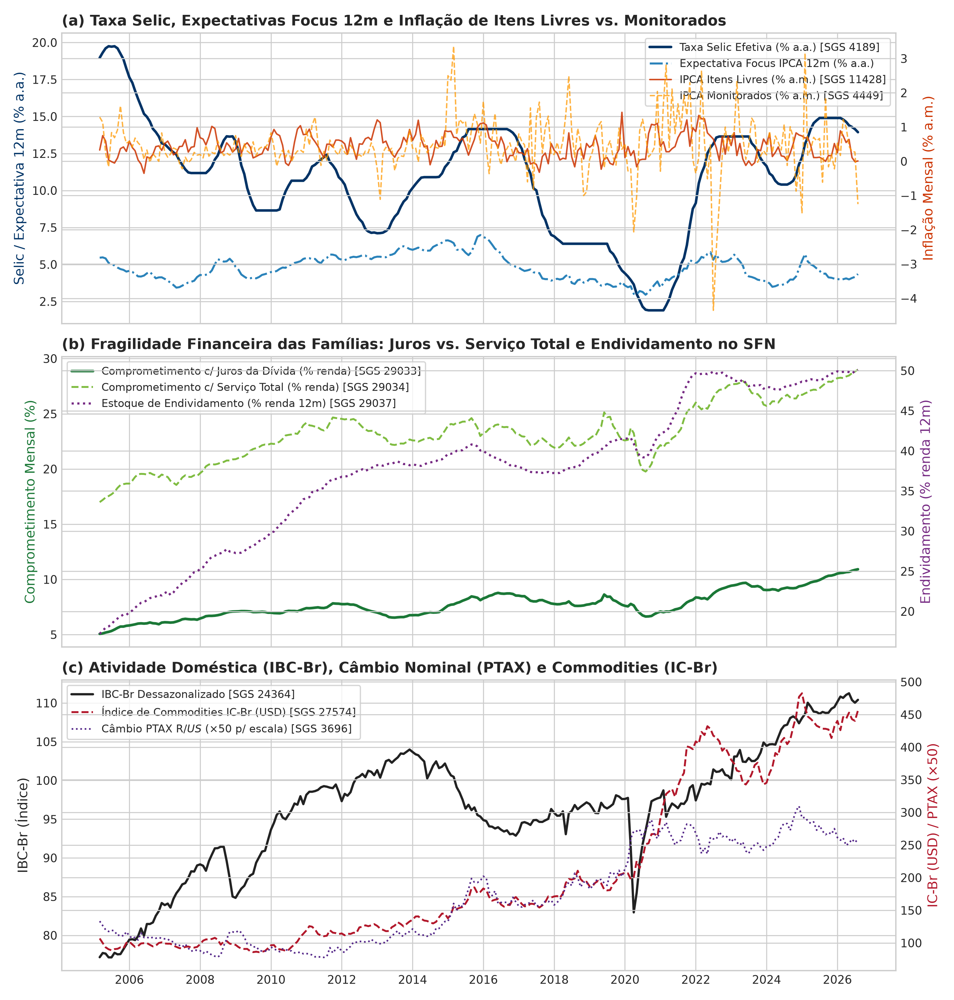
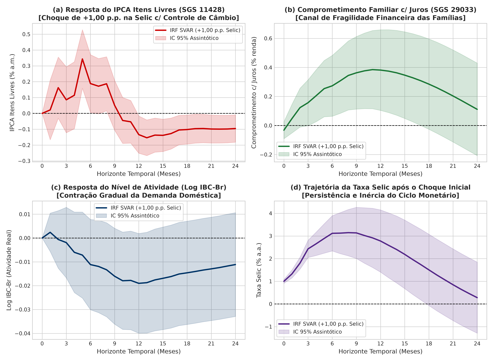
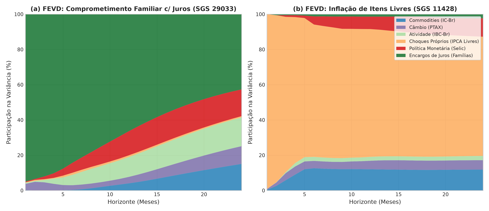
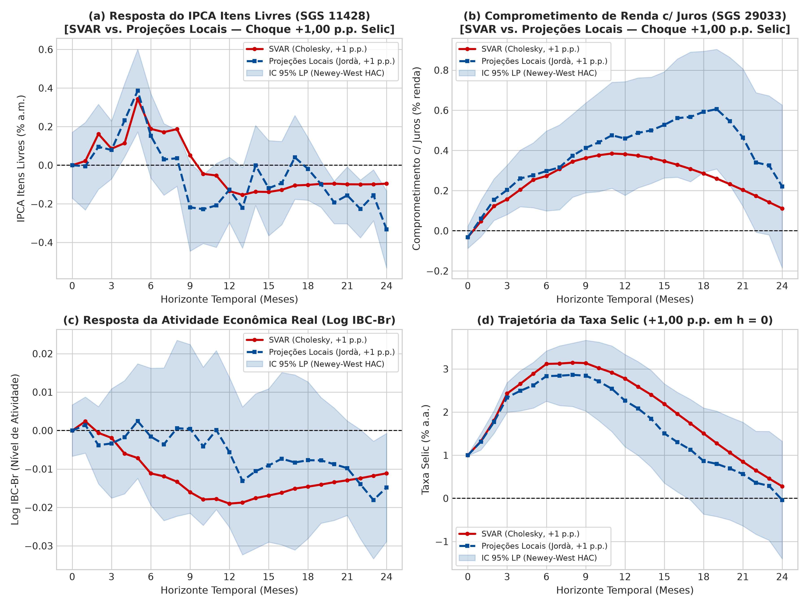
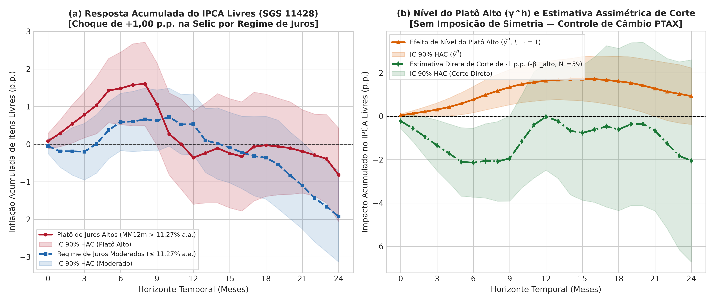

# Patamar de Juros, Dívida Pós-Fixada e Fragilidade Financeira das Famílias

**Formalização Analítica e Evidência de Projeções Locais Dependentes de Estado para o Brasil (2005–2026)**

**Autor:** Ângelo Augusto Bonvenuto  
*Pesquisador Independente em Macroeconomia Aplicada e Econometria de Séries Temporais*

---

## 📌 Visão Geral do Projeto

Este repositório reúne o artigo acadêmico completo (em Markdown, LaTeX e PDF compilado), a base de dados macroeconômicos oficiais do Banco Central do Brasil (BCB/SGS e API Olinda/Focus) e o pacote de replicação econométrica em Python voltados a investigar analítica e empiricamente a transmissão da política monetária brasileira sob diferentes patamares de juros. O estudo formaliza em um modelo fechado de três blocos e submete a testes econométricos as proposições de **André Lara Resende** (1980, 2017, 2020, 2022) e de seu ensaio ***[Eu Acuso: uma proposta para eliminar os juros absurdos](Um%20C%C3%A9tico%20Esperan%C3%A7oso%20-%20Eu%20Acuso_%20uma%20proposta%20para%20eliminar%20os%20juros%20absurdos.pdf)*** (setembro de 2026), dialogando com a literatura de dominância fiscal (Loyo, 1999; Blanchard, 2004; Favero & Giavazzi, 2004), Teoria Fiscal do Nível de Preços (Sims, 2011; Cochrane, 2011, 2023, 2026), equilíbrio neo-fisheriano (Uribe, 2022; García-Schmidt & Woodford, 2019) e canal de custos (Barth & Ramey, 2001; Ravenna & Walsh, 2006).

### 🎯 Eixos Analíticos e Empíricos Investigados

1. **Aritmética da Dívida Pública e Déficit Nominal:** Com um déficit primário entre os menores das grandes economias ($-0{,}4\%$ a $-0{,}7\%$ do PIB), o déficit nominal brasileiro de quase $10\%$ do PIB decorre do fluxo de juros ($10{,}5\%$ do PIB sobre uma DBGG de $82{,}5\%$ do PIB). Quando a taxa média da dívida ($\bar{i}_t \approx 12\%$ a.a.) supera mais que o dobro do crescimento nominal do PIB ($g_{nom} \approx 5{,}5\%$ a.a.), o componente autônomo $(\bar{i}_t - g_{nom})b_{t-1}$ expande a razão dívida/PIB em $\approx 5{,}4$ a $5{,}7$ p.p. ao ano exclusivamente pelo serviço de juros.
2. **O Mecanismo da *Duration* Zero (LFTs) sob a TFNP:** Diferentemente de economias cuja dívida é pré-fixada de longa maturidade (onde quedas na taxa básica valorizam o estoque de títulos a preços de mercado), cerca de metade da dívida mobiliária federal brasileira ($\lambda \approx 0{,}50$) é indexada à Selic diária via Letras Financeiras do Tesouro (LFTs, *duration* zero). Demonstra-se analiticamente que uma redução de $5{,}0$ p.p. na Selic comprime imediatamente o fluxo anualizado de juros em $\approx 2{,}3\%$ do PIB no impacto (chegando a $\approx 4{,}0\%$ do PIB após a rolagem das demais parcelas) sem gerar efeito riqueza positivo sobre os detentores de títulos.
3. **Assimetria de Regime na Transmissão da Selic sobre a Inflação Livre:** Avalia-se se o efeito de choques monetários sobre a inflação acumulada de itens livres (SGS 11428) difere estatisticamente entre o **Regime de Juros Moderados** ($\overline{\text{Selic}}_{12m} \le 11{,}27\%$ a.a.) e o **Platô de Juros Altos** ($\overline{\text{Selic}}_{12m} > 11{,}27\%$ a.a., ou juro real *ex ante* $> 6{,}18\%$ a.a.).
4. **Fragilidade Financeira das Famílias:** Testa-se o efeito de choques na Selic sobre o comprometimento mensal da renda das famílias exclusivamente com o pagamento de juros bancários (SGS 29033), controlando por amortizações e pelo repasse cambial.

---

## 🔬 Metodologia Econométrica e Base de Dados (2005–2026)

Sobre uma amostra mensal contínua de **258 observações (março/2005 a agosto/2026)** extraídas das APIs SGS e Olinda (Focus) do Banco Central do Brasil:

| Variável no Modelo | Código Oficial BCB | Descrição Oficial e Unidade |
| :--- | :---: | :--- |
| `l_icbr` | SGS `27574` | Logaritmo do Índice de Commodities Brasil ($\ln(\text{IC-Br}_t)$) |
| `l_ptax` | SGS `3696` | Logaritmo da Taxa de Câmbio Nominal PTAX ($\ln(\text{R\$/US\$}_t)$, fim de período) |
| `l_ibcbr` | SGS `24364` | Logaritmo do Índice de Atividade Econômica do BCB dessazonalizado ($\ln(\text{IBC-Br}_t)$) |
| `ipca_livres` | SGS `11428` | Inflação mensal de **Preços Livres** do IPCA (% a.m.) |
| `selic` | SGS `4189` | Taxa de Juros — Selic acumulada no mês anualizada base 252 (% a.a.) |
| `juros_divida` | SGS `29033` | Comprometimento de renda das famílias com **juros** da dívida com o SFN (% dessazonalizado) |
| `ipca_cheio` | SGS `433` | IPCA Índice Geral (% a.m.) — utilizado em testes de robustez |
| `ipca_monit` | SGS `4449` | IPCA Itens Monitorados (% a.m.) — utilizado em diagnósticos auxiliares |
| `serv_divida` | SGS `29034` | Comprometimento total de renda com serviço da dívida (juros + amortizações, %) |
| `focus_ipca_12m` | Olinda `Expectativas` | Mediana Focus para a inflação IPCA acumulada nos próximos 12 meses suavizada (% a.a.) |

### Estratégia de Estimação

1. **VAR Estrutural (SVAR) de 6 Variáveis:** Identificação recursiva de Cholesky ($p = 2$ via BIC/HQIC; robustez com $p = 4$ e $p = 6$ via AIC) sobre $\mathbf{Y}_t = [\ln(\text{IC-Br}_t), \, \ln(\text{PTAX}_t), \, \ln(\text{IBC-Br}_t), \, \pi^{\text{livres}}_t, \, \text{Selic}_t, \, \text{Juros Dívida}_t]'$, com normalização exata do choque estrutural para **$+1{,}00$ p.p. na taxa Selic em $h = 0$** (Plagborg-Møller & Wolf, 2021).
2. **Projeções Locais Lineares (Jordà, 2005):** Estimação direta horizonte a horizonte ($h = 0, \dots, 24$) com erros-padrão robustos de Newey-West (HAC) e mesma normalização de $+1{,}00$ p.p. na Selic.
3. **Projeções Locais Dependentes de Estado e Assimétricas (Tenreyro & Thwaites, 2016):**
   - Estimação separada dos multiplicadores dinâmicos no **Platô de Juros Altos** ($\hat{\beta}_{alto}^h$, quando $\overline{\text{Selic}}_{12m, t-1} > 11{,}27\%$ a.a.) e no **Regime de Juros Moderados** ($\hat{\beta}_{mod}^h$, quando $\le 11{,}27\%$ a.a.), além do intercepto de nível do regime alto ($\hat{\gamma}^h$) e do teste de Wald de igualdade de regimes.
   - **Decomposição Assimétrica:** Separação explícita entre choques de aperto ($\text{Shock}_t^+ = \max(\text{Shock}_t, 0)$) e choques de corte ($\text{Shock}_t^- = \min(\text{Shock}_t, 0)$) dentro do platô de juros altos, sem impor simetria paramétrica a priori.
   - **Bateria de Robustez (7 especificações):** Controles para expectativas Focus 12 meses (Nakamura & Steinsson, 2018), juro real *ex ante* ($r_t^{ex\text{-}ante} = \text{Selic}_t - E_t[\pi_{t+12}] > 6{,}18\%$ a.a.), IPCA Cheio (SGS 433), dummies de COVID-19 e sazonalidade mensal, e limiares alternativos ($P_{60} = 11{,}90\%$ a.a. e limiar fixo de $12{,}00\%$ a.a.).

---

## 📊 Principais Resultados Empíricos

- **Elevação Robusta dos Encargos de Juros das Famílias (SGS 29033):** Um choque positivo de $+1{,}00$ p.p. na Selic eleva de forma estatisticamente significativa e persistente a fração da renda familiar comprometida com juros bancários tanto no SVAR quanto nas Projeções Locais: **$+0{,}204$ p.p. em 3 meses ($p = 0{,}001$), $+0{,}298$ p.p. em 6 meses ($p = 0{,}003$), $+0{,}459$ p.p. em 12 meses ($p = 0{,}001$) e $+0{,}593$ p.p. em 18 meses ($p < 0{,}001$)**. Na FEVD do SVAR, a Selic explica até **$16{,}18\%$** da variância de `juros_divida` (superando a participação do IBC-Br, de $14{,}44\%$).
- **Eficácia Convencional no Regime Moderado vs. Ineficácia no Platô de Juros Altos:**
  - No **Regime de Juros Moderados ($\le 11{,}27\%$ a.a.)**, o aperto monetário funciona convencionalmente e reduz a inflação acumulada de preços livres (SGS 11428) em **$-1{,}922$ p.p. em 24 meses ($p = 0{,}009$)**.
  - No **Platô de Juros Altos ($> 11{,}27\%$ a.a.)**, choques adicionais de aperto associam-se a acréscimos estatisticamente significativos na inflação acumulada de curto prazo (**$+0{,}782$ p.p. em 3 meses, $p = 0{,}035$; $+1{,}485$ p.p. em 6 meses, $p = 0{,}011$**, com teste de Wald de igualdade de regimes $p = 0{,}041$) e não apresentam efeito desinflacionário estatisticamente significativo em 24 meses ($-0{,}819$ p.p., $p = 0{,}278$).
- **Efeito de Nível do Platô Alto ($\hat{\gamma}^h$) e Assimetria de Cortes ($\hat{\beta}_{alto}^{-,h}$):**
  - Estar estacionado no platô de juros altos adiciona autonomamente **$+0{,}770$ p.p. ($h=6$, $p=0{,}036$), $+1{,}154$ p.p. ($h=9$, $p=0{,}009$), $+1{,}638$ p.p. ($h=12$, $p=0{,}002$) e $+1{,}612$ p.p. ($h=18$, $p=0{,}021$)** à inflação acumulada de preços livres — resultado que permanece significativo após controlar pelas expectativas Focus 12m ($+0{,}974$ p.p. em $h=12$, $p=0{,}028$) e pelo juro real *ex ante* ($+0{,}974$ p.p. em $h=12$, $p=0{,}022$).
  - Na estimação assimétrica irrestrita, o coeficiente sobre cortes no platô alto é positivo ($\hat{\beta}_{alto}^{-,3} = +1{,}344$, $p = 0{,}058$; $\hat{\beta}_{alto}^{-,6} = +2{,}140$, $p = 0{,}027$), indicando que uma redução de $-1{,}00$ p.p. na Selic a partir do platô alto associou-se a uma queda de **$-1{,}34$ p.p. ($h=3$) a $-2{,}14$ p.p. ($h=6$)** na inflação acumulada nos dois trimestres seguintes.

### Síntese Visual dos Resultados

| Figura | Descrição |
| :--- | :--- |
|  | **Figura 1:** Evolução histórica das 6 séries macroeconômicas oficiais do BCB (2005–2026). |
|  | **Figura 2:** Funções de Resposta ao Impulso (IRF) do SVAR normalizadas para choque de $+1{,}00$ p.p. na Selic. |
|  | **Figura 3:** Decomposição da Variância do Erro de Previsão (FEVD) para IPCA Livres (11428) e Juros das Famílias (29033). |
|  | **Figura 4:** Comparação Normalizada ($+1{,}00$ p.p. Selic em $h=0$): SVAR (Cholesky) vs. Projeções Locais Lineares (Jordà, 2005). |
|  | **Figura 5:** Projeções Locais Dependentes de Estado (Platô Alto vs. Moderado), Nível do Regime Alto ($\hat{\gamma}^h$) e Efeito Assimétrico Direto de Corte ($-\hat{\beta}_{alto}^{-,h}$). |

---

## 📁 Estrutura do Repositório

```bash
artigo-politica-monetaria/
├── README.md                                  # Documentação e síntese do projeto
├── artigo_hipotese_lara_resende.md            # Artigo completo em Markdown
├── artigo_svar_lara_resende.tex               # Manuscrito acadêmico em LaTeX
├── artigo_svar_lara_resende.pdf               # Artigo compilado em PDF (24 páginas)
├── referencias.bib                            # Bibliografia completa em BibTeX (30 referências)
├── Um Cético Esperançoso - Eu Acuso_...pdf    # Ensaio de referência de André Lara Resende (set/2026)
├── data/
│   └── base_macro_bcb.csv                     # Base mensal BCB/SGS + Focus Olinda (258 obs: 2005-03 a 2026-08)
├── scripts/
│   ├── estimacao_svar_lara_resende.py         # Coleta BCB/Olinda, testes ADF, SVAR 6 variáveis, IRFs (+1 p.p.) e FEVD
│   ├── estimacao_local_projections.py         # Projeções Locais lineares normalizadas (+1 p.p., Jordà, 2005)
│   ├── estimacao_regime_juros_altos.py        # LPs Dependentes de Estado, Assimétricas e 7 Testes de Robustez
│   └── test_bcb_api.py                        # Teste de conectividade com a API SGS/BCB
├── resultados/
│   ├── resultados_svar_summary.txt            # Resumo estatístico do SVAR (p=2, 4, 6), IRFs e FEVD
│   ├── comparacao_svar_vs_lp.txt              # Tabela comparativa normalizada SVAR vs. LP Linear
│   └── regime_juros_altos_lp.txt              # Tabelas das LPs Dependentes de Estado, Assimétricas e Robustez
└── figuras/
    ├── figura1_series_historicas.png          # Evolução histórica das 6 séries (2005–2026)
    ├── figura2_irf_svar.png                   # IRFs do modelo SVAR (+1.00 p.p. Selic)
    ├── figura3_fevd_svar.png                  # Decomposição de Variância (FEVD)
    ├── figura4_lp_vs_svar.png                 # Comparativo normalizado SVAR vs. Projeções Locais
    └── figura5_regime_juros_altos_lp.png      # Efeito do Platô de Juros Altos, Nível e Corte Assimétrico
```

---

## 🚀 Como Replicar a Estimação e o PDF

```bash
# 1. Atualizar a base BCB/Olinda, estimar o SVAR (6 variáveis) e gerar as Figuras 1, 2 e 3:
uv run --with pandas,numpy,statsmodels,matplotlib,requests python3 scripts/estimacao_svar_lara_resende.py

# 2. Estimar as Projeções Locais lineares normalizadas (+1.00 p.p.) e gerar a Figura 4:
uv run --with pandas,numpy,statsmodels,matplotlib python3 scripts/estimacao_local_projections.py

# 3. Estimar as Projeções Locais Dependentes de Estado, Assimétricas e Bateria de Robustez (Figura 5):
uv run --with pandas,numpy,statsmodels,matplotlib,scipy python3 scripts/estimacao_regime_juros_altos.py

# 4. Compilar o manuscrito LaTeX para PDF:
latexmk -pdf -interaction=nonstopmode artigo_svar_lara_resende.tex
```
