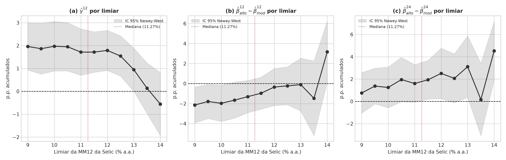

# O Patamar dos Juros Altera a Transmissão da Política Monetária? Evidência de Projeções Locais Dependentes de Estado e do Comprometimento de Renda das Famílias no Brasil (2005–2026)

**Autor:** Ângelo Augusto Bonvenuto  
*Pesquisador independente. Dados e código de replicação: <https://github.com/bonvenuto/artigo-politica-monetaria>.*

---

### Resumo

Este artigo testa se a eficácia desinflacionária da política monetária no Brasil depende do patamar dos juros, hipótese inspirada nas teses de André Lara Resende. Com dados mensais de 2005 a 2026, identificamos inovações na Selic em um VAR recursivo e estimamos projeções locais dependentes do regime de juros. Na especificação-base, a resposta da inflação de itens livres não difere entre o platô de juros altos e o regime moderado, e o teste sobre uma grade de limiares, calibrado por bootstrap, não rejeita a igualdade. O resultado é inconclusivo: diferenças de até cerca de 0,4 p.p. por choque de 1 desvio-padrão, maiores que o efeito estimado no regime moderado em 24 meses, seriam detectadas com probabilidade inferior a 80%, e as evidências pontuais favoráveis à hipótese (controles interagidos, $p = 0{,}11$ calibrado; limiar de 14%) perdem significância quando calibradas. A queda da inflação em 24 meses no regime moderado depende do número de defasagens e da medida da taxa de juros. A permanência no platô associa-se a inflação acumulada mais alta em 12 meses, compatível com a equação de Fisher e com a regra de reação e não significativa sob bootstrap. Um choque de 1 desvio-padrão eleva o comprometimento da renda das famílias com juros em 0,07 a 0,09 p.p. em 12 a 18 meses, pela alta da taxa implícita das dívidas, efeito robusto entre especificações, mas marginal sob calibração; não se detecta efeito no endividamento nem no serviço total. O canal da dívida pública pós-fixada não é testado.

**Palavras-chave:** política monetária; projeções locais dependentes de estado; taxa Selic; interação monetária-fiscal; comprometimento de renda das famílias; Brasil.

**Classificação JEL:** E43, E52, E58, E62, C32.

---

### Abstract

We test whether the disinflationary effectiveness of monetary policy in Brazil depends on the level of interest rates, a hypothesis inspired by André Lara Resende's arguments on persistently high rates. Using monthly data from 2005 to 2026, we identify Selic innovations in a recursive VAR and estimate regime-dependent local projections. In the baseline specification, the response of free-price inflation does not differ between the high-rate plateau and the moderate regime, and a test over a grid of thresholds, calibrated by a bootstrap under the linearity null, does not reject equality. The result is inconclusive: differences of up to about 0.4 p.p. of cumulative inflation per one-standard-deviation shock, larger than the estimated 24-month effect in the moderate regime, would be detected with less than 80% probability, and the pointwise evidence in favour of the hypothesis (interacted controls, calibrated $p = 0.11$; a 14% threshold) loses significance once calibrated. The 24-month disinflation in the moderate regime depends on the lag length and on the interest-rate measure. Remaining in the plateau is associated with higher cumulative inflation 12 months ahead, consistent with the Fisher equation and with the reaction function and not significant under the bootstrap. A one-standard-deviation shock raises the household interest-to-income ratio by 0.07 to 0.09 p.p. at 12 to 18 months, through a higher implicit rate on debt, an effect robust across specifications but marginal once calibrated; no effect on indebtedness or on total debt service is detected. The floating-rate public debt channel is not tested.

**Keywords:** monetary policy; state-dependent local projections; Selic rate; monetary-fiscal interaction; household debt service; Brazil.

---

## 1. Introdução

O Brasil convive há duas décadas com juros reais entre os mais altos do mundo. Há mecanismos conhecidos pelos quais, nesse ambiente, a taxa básica pode perder potência como instrumento desinflacionário ou operar também por canais que pressionam preços: o custo financeiro das empresas (Barth & Ramey, 2001; Ravenna & Walsh, 2006) e o custo da dívida pública, que afeta a percepção de solvência do Estado, tema da literatura de interação monetária-fiscal (Loyo, 1999; Blanchard, 2005; Favero & Giavazzi, 2005). Lara Resende desenvolveu críticas à ortodoxia monetária em livros (Lara Resende, 2017, 2020, 2022). Em ensaio recente, Lara Resende (2026) retoma essa crítica: argumenta que o serviço da dívida é o motor do crescimento da razão dívida/PIB, que a participação de títulos atrelados à Selic reduz o risco de um repique inflacionário após cortes de juros e que, no longo prazo, juros e inflação andam juntos, como na leitura neo-fisheriana de Cochrane (2023); o ensaio relata ainda que posts recentes de Cochrane (2026) defendem reduzir os juros encurtando a maturidade da dívida. Daí deriva a proposta de reduzir a Selic de forma coordenada para cerca de 7,5% a.a.

Este artigo pergunta se os dados mensais de 2005 a 2026 mostram a dependência de estado que essa crítica sugere: *a resposta da inflação a surpresas da Selic é diferente quando os juros estão em um platô persistentemente alto?* A pergunta não é a mesma que o ensaio de 2026 coloca. O ensaio trata de uma mudança permanente e coordenada do patamar de juros, enquanto surpresas mensais em torno da regra de reação do Banco Central são transitórias. A Tabela 1 separa, por isso, os componentes da tese que este artigo testa dos que ele não testa.

As contribuições são três. Primeiro, testamos a dependência de estado com projeções locais (Jordà, 2005; Tenreyro & Thwaites, 2016; Ramey & Zubairy, 2018) e delimitamos o que dados mensais agregados conseguem identificar sobre ela: com cinco episódios de platô, o teste tem pouco poder. Reportamos o intervalo da diferença entre regimes, o efeito mínimo detectável e limites unilaterais, com inferência robusta (EWC, bootstrap de blocos, bandas simultâneas e bootstrap sob a nula de linearidade com reestimação do choque e do estado, aplicado também à especificação interagida e à grade de limiares), e mostramos como o resultado depende do número de defasagens, da medida da taxa de juros, do limiar e da especificação. Segundo, quantificamos o canal de juros das famílias e o decompomos entre taxa implícita e estoque de dívida, com o mesmo choque e os mesmos controles para juros, amortização, serviço total e endividamento. Terceiro, como observação analítica, recolocamos a aritmética fiscal do corte de juros em termos reais e mostramos que o alívio na razão dívida/PIB depende do repasse do corte à inflação, que se anula no primeiro ano com repasse de cerca de metade.

Os resultados são os seguintes. Na especificação-base, não se detecta diferença entre regimes, e o teste calibrado sobre a grade de limiares não rejeita a igualdade; mas o teste tem pouco poder: diferenças da ordem do próprio efeito desinflacionário estimado no regime moderado seriam detectadas com probabilidade inferior a 80%. As evidências pontuais a favor de $H_1$ (a especificação totalmente interagida, com $p = 0{,}107$ calibrado, e o limiar de 14%) não resistem à calibração por bootstrap, e as contrárias (diferença negativa em 12 meses para limiares baixos) também não. O efeito desinflacionário de 24 meses no regime moderado só é significativo com seis (e, marginalmente, nove) defasagens e deixa de ser significativo quando o choque é identificado com a meta Selic de fim de mês ($p = 0{,}057$). A permanência no platô associa-se a inflação acumulada mais alta em 9 a 12 meses, mas essa associação de nível é compatível com a equação de Fisher e com a regra de reação, desaparece para limiares acima de 13% e não é significativa a 5% sob bootstrap ($p = 0{,}093$). O resultado mais robusto entre especificações é o aumento do comprometimento de renda das famílias com juros após surpresas positivas da Selic, com pico entre 12 e 18 meses, explicado pela alta da taxa implícita das dívidas e não pelo estoque; com valor crítico calibrado por bootstrap, porém, ele é marginal em 12 meses ($p \approx 0{,}08$). O resultado documenta o repasse convencional da Selic, e não evidência a favor ou contra a tese.

O restante do artigo organiza-se assim. A Seção 1.1 situa o trabalho na literatura, e a Seção 1.2 formula as hipóteses. A Seção 2 apresenta um arcabouço motivador e a aritmética fiscal. A Seção 3 descreve dados e estratégia empírica. A Seção 4 traz os resultados, a Seção 5 discute o que eles informam e o que não informam, e a Seção 6 conclui.

### 1.1. Literatura relacionada

**Dependência de estado na transmissão monetária.** Tenreyro & Thwaites (2016) mostram, com projeções locais e modelos de transição suave, que a política monetária americana é menos potente em recessões, e Ramey & Zubairy (2018) discutem as armadilhas de LPs dependentes de estado. Plagborg-Møller & Wolf (2021) mostram que LPs e VARs estimam as mesmas respostas na população. Este artigo aplica o mesmo instrumental a um estado definido pelo patamar dos juros, e não pelo ciclo.

**Interação monetária e fiscal.** A ideia de que a política monetária pode ter efeitos perversos sem respaldo fiscal remonta a Sargent & Wallace (1981) e foi formalizada por Leeper (1991) e Woodford (2001). Cochrane (2001), Sims (2011) e Cochrane (2023) mostram que, sob a Teoria Fiscal do Nível de Preços (TFNP), a maturidade da dívida determina a magnitude do efeito de curto prazo de uma mudança de juros. Para o Brasil, Loyo (1999) descreve o paradoxo do dinheiro apertado com dívida indexada ao *overnight*, Tanner & Ramos (2003) encontram evidência mista de dominância monetária nos anos 1990, e Blanchard (2005) e Favero & Giavazzi (2005) mostram que, em 2002–2003, juros mais altos podiam elevar o risco de *default*, depreciar o câmbio e acelerar a inflação.

**Juro real elevado e efeito neo-fisheriano.** Arida et al. (2005) atribuíram o alto juro real brasileiro à incerteza jurisdicional e à inconversibilidade, conjectura cuja evidência em painel é, em geral, desfavorável (Gonçalves et al., 2007). Uribe (2022) estima que aumentos permanentes da taxa nominal elevam a inflação já no curto prazo, enquanto aumentos transitórios a reduzem. García-Schmidt & Woodford (2019) mostram que a conclusão neo-fisheriana obtida sob previsão perfeita é frágil quando as expectativas são formadas por raciocínio reflexivo.

**Identificação e evidência para o Brasil.** Em VARs recursivos, a resposta positiva da inflação a choques de juros (*price puzzle*) costuma indicar omissão de informação prospectiva (Sims, 1992). Para o Brasil, Minella (2003) e Céspedes et al. (2008) documentam respostas da inflação a choques de juros com VARs. Nakamura & Steinsson (2018) destacam o efeito-informação das surpresas monetárias, e McLeay & Tenreyro (2020) mostram que a baixa correlação entre hiato e inflação em formas reduzidas não implica uma curva de Phillips estrutural horizontal. O canal de custos (Barth & Ramey, 2001; Ravenna & Walsh, 2006) e as leituras pós-keynesianas da distribuição de juros (Lavoie, 1995; Hein, 2007) fornecem mecanismos pelos quais o aperto pode elevar custos; a inércia inflacionária brasileira foi discutida, entre outros, por Lopes & Lara Resende (1979).

**Finanças das famílias.** A literatura de *debt service ratios* (Drehmann et al., 2015) e os trabalhos sobre a heterogeneidade da transmissão entre devedores e credores (Cloyne et al., 2020; Auclert, 2019) motivam a análise do comprometimento de renda com juros.

### 1.2. Hipóteses e o que é testado

- **$H_1$ (dependência de estado):** a eficácia desinflacionária de surpresas da Selic depende do regime de juros. Na Equação (11), $H_1$ implica (i) $\beta_{mod}^h < 0$ em 12–24 meses; (ii) $\beta_{alto}^h \ge 0$ no platô; e (iii) $\beta_{alto}^h > \beta_{mod}^h$. Só a implicação (iii) distingue $H_1$ de uma transmissão homogênea estimada com imprecisão. $H_1$ não é uma previsão explícita de Lara Resende (2026); é a forma testável com surpresas mensais da conjectura de que a política monetária, “se dissociada da política fiscal, é ineficaz e pode ter efeitos perversos”, que o ensaio atribui à TFNP.

- **$H_1'$ (nível do platô):** condicionalmente às defasagens do sistema, a permanência no platô associa-se a inflação acumulada mais alta ($\gamma^h > 0$). Por ser uma associação de nível, $H_1'$ não discrimina entre teorias: é o que preveem a equação de Fisher e uma regra de reação que mantém juros altos quando a inflação é persistente.

- **$H_2$ (comprometimento das famílias):** surpresas positivas da Selic elevam a parcela da renda das famílias comprometida com juros. O ensaio de 2026 afirma que os juros altos provocam “o endividamento insustentável das famílias”. Pela Equação (7), o sinal é quase mecânico; o conteúdo empírico de $H_2$ está na magnitude, na persistência, na decomposição entre taxa e estoque e na transmissão ao serviço total.

#### Tabela 1: Componentes da tese, hipóteses deste artigo e o que é testado

| **Componente** | **Onde aparece** | **Hipótese** | **Testado aqui?** |
| :--- | :---: | :---: | :---: |
| Juros e inflação positivamente correlacionados no longo prazo (neo-Fisher) | Lara Resende (2026), via Cochrane (2023) | — | Não: exige variação permanente do patamar; surpresas mensais são transitórias (Uribe, 2022) |
| Dívida curta (LFT) evita repique inflacionário após corte | Lara Resende (2026) | — | Não: surpresas negativas não são cortes anunciados (Seção 4.4) |
| Juros altos tornam a dívida explosiva; corte gera economia fiscal | Lara Resende (2026) | — | Não estimado; aritmética em termos reais na Seção 2.2 |
| Câmbio como canal de curto prazo, neutralizável por reservas | Lara Resende (2026); Blanchard (2005) | — | Parcialmente: câmbio por regime (Tabela 12); sem CDS/EMBI |
| Juros persistentemente altos perdem potência desinflacionária | Loyo (1999); Blanchard (2005); formulação operacional deste artigo | $H_1$ | Sim, para surpresas transitórias |
| Canal de custos do capital de giro | Barth & Ramey (2001); Ravenna & Walsh (2006) | $H_1$ (ii) | Indiretamente; não identificado em separado |
| Juros altos elevam a carga de juros das famílias | Formulação deste artigo, a partir de Lara Resende (2026) | $H_2$ | Sim: repasse da Selic à taxa implícita (Seção 4.7) |
| Juros altos provocam “o endividamento insustentável das famílias” | Lara Resende (2026) | $H_2$ | Testado: sem efeito detectável sobre o endividamento (Tabela 11) |
| Curva de Phillips horizontal: “recessão e capacidade ociosa não reduzem a inflação” | Lara Resende (2026) | — | Não identificado: o desenho não separa a inclinação da curva de outros canais |
| Proposta de redução coordenada da Selic | Lara Resende (2026) | — | Não avaliada |

## 2. Arcabouço Motivador e Aritmética Fiscal

Esta seção organiza os canais pelos quais uma variação da Selic afeta a inflação, a dívida pública e o orçamento das famílias. Ela não é um modelo de equilíbrio resolvido nem gera uma restrição que as estimativas da Seção 4 confrontem: serve para nomear os canais e para mostrar sob que condições a resposta de impacto da inflação poderia mudar de sinal.

### 2.1. Canais de transmissão

Com firmas que financiam uma fração $\alpha$ de custos por capital de giro à taxa $(1+s_{\text{firm}})i_t$ (Barth & Ramey, 2001; Ravenna & Walsh, 2006), a curva de Phillips híbrida com canal de custos e repasse cambial é

$$\pi_t = (1 - \chi) \pi_{t-1} + \chi E_t [\pi_{t+1}] + \kappa y_t + \phi i_t + \psi \Delta e_t + \epsilon_t^\pi, \tag{1}$$

em que $\chi$ é o peso prospectivo, $\kappa \ge 0$ a inclinação, $\phi = \frac{(1-\xi)(1-\beta\xi)}{\xi}\alpha(1+s_{\text{firm}}) > 0$ o canal de custos ($\xi$ é a probabilidade de Calvo) e $\psi > 0$ o repasse cambial. A demanda segue uma curva IS com um termo de renda financeira sobre a dívida pública atrelada à Selic:

$$y_t = E_t[y_{t+1}] - \sigma \left( i_t - E_t[\pi_{t+1}] - r_t^* \right) + \delta \lambda b_{t-1} i_t + \epsilon_t^y, \tag{2}$$

em que $b_{t-1}$ é a razão dívida/PIB e $\lambda$ a fração atrelada à Selic. Acrescentamos um canal de solvência fiscal nas expectativas e um prêmio de risco na paridade descoberta (Blanchard, 2005):

$$E_t[\pi_{t+1}] = (1 - \omega) \pi^{meta} + \omega \pi_{t-1} + \theta \frac{\lambda b_{t-1}}{1 + g_{nom}} i_t, \qquad
\Delta e_t = -\mu (i_t - i_t^{ext} - \rho(b_t)) + \epsilon_t^e, \tag{3}$$

com $\theta \ge 0$ e $\rho'(b) \ge 0$. Esse canal é de solvência e de prêmio de risco; não é a equação de valoração da TFNP, que relacionaria o valor real da dívida ao valor presente dos superávits primários (Cochrane, 2023). Tomando $E_t[y_{t+1}]$, $i_t^{ext}$ e $b_{t-1}$ como dados, a derivada de impacto é

$$\frac{\partial\pi_t}{\partial i_t} = \underbrace{\phi}_{\text{custos }(+)} - \underbrace{\kappa (\sigma - \delta \lambda b_{t-1})}_{\text{demanda }(-)} - \underbrace{\psi \mu}_{\text{câmbio }(-)} + \underbrace{\frac{\lambda b_{t-1}}{1 + g_{nom}} \left[ (\chi + \kappa \sigma) \theta + \psi \mu \rho'(b_t) \right]}_{\text{solvência e prêmio de risco }(+)}. \tag{4}$$

A Equação (4) não resolve o equilíbrio dinâmico e não deriva a dependência de estado: para que a resposta seja menos negativa no platô, é preciso *supor* que $\theta$ e $\rho'$ crescem com o patamar dos juros ou com $\lambda b$. Os parâmetros $\phi$, $\kappa$, $\sigma$, $\mu$ e $\rho'$ não são estimados neste artigo. O estado usado na Seção 4 (a média móvel da Selic) também não é o estado do modelo ($\lambda b$): nenhuma especificação estimada inclui a composição da dívida, o resultado nominal ou o prêmio soberano. O canal da dívida pós-fixada, portanto, **não é testado** neste artigo.

### 2.2. Aritmética fiscal do corte de juros em termos reais

A razão dívida/PIB evolui segundo

$$b_t = \frac{1 + \bar{i}_t}{1 + g_{nom,t}} b_{t-1} - s_t^{prim}, \tag{5}$$

em que $\bar{i}_t$ é o custo nominal médio do estoque, $g_{nom,t}$ o crescimento do PIB nominal e $s_t^{prim}$ o superávit primário. A Tabela 2 reúne os insumos, com fonte, data e conceito. Com o custo médio da DPF de 12,63% (RMD) e crescimento nominal de 7,22%, o termo $(\bar{i} - g_{nom})/(1+g_{nom})$ é de 5,05% e, sobre a DBGG de 82,9% do PIB, contribui com cerca de 4,2 p.p. do PIB por ano para o crescimento da razão. Na base das NFSP, com a taxa implícita de 14,8% dos juros nominais sobre a DLSP, o termo equivalente é de 4,6 p.p. do PIB. A DBGG subiu 5,6 p.p. entre agosto de 2025 e agosto de 2026, variação que inclui também o déficit primário e outros fatores condicionantes. O ensaio de 2026 cita uma diferença de cerca de 5,7% ao ano entre o custo da dívida e o crescimento nominal (Lara Resende, 2026); com os insumos da Tabela 2, a diferença $\bar{i} - g_{nom}$ é de 5,4 p.p., e a distância reflete insumos de data anterior, que o ensaio não especifica.

#### Tabela 2: Insumos fiscais (referência: agosto de 2026, salvo indicação)

| **Indicador** | **Valor** | **Fonte e conceito** |
| :--- | :---: | :---: |
| Dívida bruta do governo geral (DBGG) | 82,87% PIB | SGS 13762; estoque |
| Dívida líquida do setor público (DLSP) | 69,27% PIB | SGS 4513; estoque |
| Juros nominais em 12 meses | 8,86% PIB | SGS 5727 menos SGS 5793; fluxo, setor público consolidado |
| Déficit primário em 12 meses | 0,62% PIB | SGS 5793 |
| Crescimento do PIB nominal em 12 meses | 7,22% | SGS 4382 |
| IPCA em 12 meses | 4,22% | SGS 13522 |
| Selic (acumulada no mês, anualizada) | 13,94% a.a. | SGS 4189 |
| Custo médio da DPF em 12 meses (set./2026) | 12,63% a.a. | RMD (Secretaria do Tesouro Nacional, 2026); DPMFi: 13,03% |
| Títulos de taxa flutuante na DPF (set./2026) | 51,60% | RMD; 52,74% em agosto |
| Títulos indexados a preços na DPF (set./2026) | 23,59% | RMD; 23,22% em agosto; 16,5% do PIB |
| Títulos prefixados / cambiais na DPF (set./2026) | 21,14% / 3,7% | RMD |
| DPF em taxa flutuante (set./2026) | 36,1% PIB | RMD e SGS 4382 (R\$ 4,84 tri / R\$ 13,40 tri) |
| Prazo médio da DPF / vencimentos em 12 meses | 4,10 anos / 19,95% | RMD |

Um corte da Selic reduz imediatamente apenas o custo da parcela atrelada à Selic, $x$ (% do PIB). O custo nominal da parcela indexada a preços, $x_{IPCA}$, acompanha a inflação, e o da parcela prefixada não se altera até a rolagem. Linearizando a Equação (5), a variação da razão no primeiro ano é

$$\Delta b \approx \frac{x\,\Delta \bar{\imath}_1}{1+g_{nom}} - \frac{b\,(1+\bar{i})}{(1+g_{nom})^2}\,\Delta g_{nom} + \frac{x_{IPCA}\,\Delta g_{nom}}{1+g_{nom}}, \qquad \Delta g_{nom} = \omega\,\Delta \bar{\imath}_1, \tag{6}$$

em que $\Delta\bar{\imath}_1$ é a variação média da Selic no primeiro ano e $\omega$ o repasse do corte à inflação e ao PIB nominal, com crescimento real inalterado. O primeiro termo é o alívio nominal. O segundo é o efeito da menor inflação sobre o denominador. O terceiro devolve o alívio da parcela indexada, cujo custo nominal cai com a inflação. Com $\omega = 1$ (ajuste fisheriano pleno), o custo real das parcelas atreladas à Selic e a preços não muda, e o da parcela prefixada sobe. Valores $\omega < 0$ representam a previsão convencional de que o corte eleva a inflação; nesse caso, a equação registra apenas o efeito mecânico sobre o PIB nominal e omite os custos de desancoragem das expectativas e de prêmio de risco. A Tabela 3 apresenta os cenários para o corte de 13,94% para 7,5% a.a. proposto no ensaio, feito gradualmente em 12 meses ($\Delta\bar{\imath}_1 = -3{,}22$ p.p.) ou de imediato, e o ponto de equilíbrio $\omega^*$ em que o corte deixa a razão inalterada. O Painel B mostra o regime permanente, depois da rolagem de todo o estoque, em que $\Delta\bar{\imath} = 7{,}5 - \bar{i}$ e o termo dos indexados é nulo, porque o custo de todo o estoque já se ajusta ao novo patamar. A linha de 51,6% da DBGG aplica a participação das taxas flutuantes na DPF ao conceito mais amplo de dívida bruta, que inclui as operações compromissadas do Banco Central, remuneradas à Selic; é um limite superior da exposição, porque supõe para a DBGG a composição da DPF. Com $\omega = 0$ e corte gradual, o alívio no primeiro ano cresce com a exposição e com o tamanho do corte: para cortes totais de 2, 4 e 6,4 p.p., vai de $-0{,}28$, $-0{,}56$ e $-0{,}90$ p.p. do PIB com $x = 30\%$ do PIB a $-0{,}47$, $-0{,}93$ e $-1{,}50$ com $x = 50\%$ (grade completa em `resultados/aritmetica_fiscal.txt`).

#### Tabela 3: Variação da razão DBGG/PIB após o corte da Selic para 7,5% a.a. (p.p. do PIB; negativo = alívio). Equação (6), com $b = 82{,}87\%$, $\bar{i} = 12{,}63\%$, $g_{nom} = 7{,}22\%$ e $x_{IPCA} = 16{,}5\%$ do PIB. $\omega^*$: repasse que anula o efeito.

| **Exposição à Selic ($x$)** | **Corte** | $\omega = -0{,}5$ | $\omega = 0$ (inflação rígida) | $\omega = 0{,}5$ | $\omega = 1$ (Fisher pleno) | $\omega^*$ |
| :--- | :---: | :---: | :---: | :---: | :---: | :---: |
| *Painel A: primeiro ano* |  |  |  |  |  |  |
| DPF em taxa flutuante (36,1% PIB) | gradual | $-2{,}14$ | $-1{,}08$ | $-0{,}03$ | $+1{,}03$ | $0{,}51$ |
|  | imediato | $-4{,}29$ | $-2{,}17$ | $-0{,}05$ | $+2{,}07$ | $0{,}51$ |
| 51,6% da DBGG (42,8% PIB) | gradual | $-2{,}34$ | $-1{,}28$ | $-0{,}22$ | $+0{,}83$ | $0{,}61$ |
|  | imediato | $-4{,}69$ | $-2{,}57$ | $-0{,}45$ | $+1{,}67$ | $0{,}61$ |
| *Painel B: regime permanente (todo o estoque refinanciado a 7,5%; sem prêmio a termo)* |  |  |  |  |  |  |
| Custo médio da DPF (12,63%) | $\Delta\bar{\imath} = -5{,}13$ | $-6{,}05$ | $-3{,}97$ | $-1{,}88$ | $+0{,}20$ | $0{,}95$ |
| Custo médio da DPMFi (13,03%) | $\Delta\bar{\imath} = -5{,}53$ | $-6{,}52$ | $-4{,}27$ | $-2{,}03$ | $+0{,}22$ | $0{,}95$ |

Três conclusões decorrem da Tabela 3. Primeiro, o alívio na razão dívida/PIB existe apenas na medida em que o corte reduz o juro *real*, isto é, na medida em que a inflação não cai na mesma proporção dos juros: no primeiro ano, ele desaparece com $\omega^* \approx 0{,}5$–$0{,}6$. O cenário do ensaio fica na região de alívio. Para Lara Resende (2026), a inflação “é inercial – tende a ficar onde está”, e, no longo prazo, converge para a diferença entre o juro básico e o crescimento real da economia (cerca de 5% com Selic de 7,5% e o crescimento real potencial de 2,5% que o ensaio adota, p. 11; o IPCA em 12 meses é de 4,22%), o que corresponde a $\omega$ próximo de zero no primeiro ano. Alívio fiscal e ausência de pressão inflacionária exigem, juntos, que o canal de demanda da política monetária seja pouco operante, hipótese que o ensaio sustenta (“recessão e capacidade ociosa não reduzem a inflação”) e que este artigo não testa. Na previsão convencional ($\omega < 0$), o alívio nominal é maior, mas os custos de desancoragem e de prêmio de risco, não modelados, podem superá-lo. Segundo, com inflação rígida e corte gradual, o alívio no primeiro ano é de 1,1 a 1,3 p.p. do PIB. Terceiro, a economia de cerca de 4% do PIB ao ano citada pelo ensaio (Lara Resende, 2026) corresponde ao Painel B com $\omega = 0$ ($-3{,}97$ p.p.; $-4{,}27$ com o custo da DPMFi). É um *limite superior* condicional: supõe inflação rígida, prêmio a termo nulo e convergência de toda a curva para 7,5%, e a rolagem levaria anos, pois só 20% da DPF vence em 12 meses e o prazo médio é de 4,1 anos. O efeito de valor presente também não desaparece: a duração das LFTs é próxima de zero, mas o corte valoriza a parcela prefixada e indexada a preços, cerca de 45% da DPF. A dívida curta reduz o canal de repique da TFNP; não o elimina (Cochrane, 2001; Sims, 2011; Cochrane, 2023).

### 2.3. Comprometimento de renda das famílias

Seguindo Drehmann et al. (2015), o comprometimento da renda com juros é

$$J_t^{fam} = \frac{\bar{i}_t^{fam} D_{t-1}^{fam}}{Y_t^{fam}}, \qquad \bar{i}_t^{fam} = \eta_{pos}\, i_t^c(i_t) + (1 - \eta_{pos})\, \bar{i}_{fixo}, \tag{7}$$

e o serviço total é $S_t^{fam} = J_t^{fam} + A_t^{fam}$, com $A_t^{fam}$ a amortização. A taxa média do estoque responde à Selic por três vias com velocidades diferentes: a parcela do estoque com taxa repactuada no curto prazo ($\eta_{pos}$); a substituição do estoque por novas concessões a taxas correntes, que é um fluxo e não uma fração do estoque; e a exposição indireta do crédito imobiliário indexado à TR, que é positiva quando a Selic é alta. Linhas como o rotativo do cartão e o cheque especial têm taxas dominadas pelo *spread* e sujeitas a tetos regulatórios em parte da amostra (8% a.m. no cheque especial desde 2020; juros e encargos do rotativo limitados a 100% do principal desde 2024), de modo que o repasse da Selic a elas é fraco. Uma alta da Selic eleva $J^{fam}$ pela taxa média, e pode reduzi-lo por desalavancagem ($D^{fam}$ menor) ou elevá-lo por queda da renda. A Seção 4.7 separa esses efeitos.

## 3. Dados e Estratégia Empírica

### 3.1. Dados

A amostra é mensal, de março de 2005 a agosto de 2026 (258 observações), limitada no início pelas séries de comprometimento de renda. As séries vêm das APIs do Banco Central (SGS e Olinda/Focus) e foram extraídas em 9 de novembro de 2026 (Tabela 4). As séries de comprometimento (29033–29038) são estimativas do BCB, e não pagamentos observados: o numerador é o valor médio estimado do serviço das dívidas, e o denominador é a média móvel trimestral da renda nacional disponível bruta das famílias restrita, mensalizada por Denton-Cholette a partir das contas anuais e retropolada antes de 2012 (Banco Central do Brasil, 2021). A NT 55 documenta o denominador; a documentação pública consultada não descreve como o BCB estima e separa juros e amortização no numerador (taxas contratadas do estoque ou taxas correntes, prazos, hipótese de anuidade), e essa limitação condiciona a leitura da Seção 4.7. As séries substituíram as antigas 19879–19882 em dezembro de 2021, quando a massa salarial ampliada disponível deu lugar à RNDBF restrita no denominador (Banco Central do Brasil, 2021), e os valores de 2005 a 2021 são reconstrução retroativa. Três consequências importam para a inferência. A média móvel induz correlação serial MA(2) por construção. A resposta em $h = 0$ mistura meses anteriores ao choque. E os dados de 2024–2026 serão revistos quando a renda anual for publicada. A Seção 4.7 trata as três.

#### Tabela 4: Séries utilizadas (BCB, extração em 9/11/2026)

| **Variável** | **Descrição** | **Código** | **Transformação** | **Papel** |
| :--- | :---: | :---: | :---: | :---: |
| $ICBr_t$ | Índice de Commodities Brasil, em US\$ | SGS 29042 | $\ln$ | Choques externos de oferta |
| $PTAX_t$ | Câmbio R\$/US\$, venda, fim de período | SGS 3696 | $\ln$ | Canal cambial |
| $IBC_t$ | IBC-Br dessazonalizado | SGS 24364 | $\ln$ | Atividade |
| $\pi_t^{livre}$ | IPCA – itens livres (% a.m., sem ajuste sazonal) | SGS 11428 | nível | Inflação |
| $\text{Selic}_t$ | Selic acumulada no mês, anualizada | SGS 4189 | nível | Instrumento |
| $J_t^{fam}$ | Comprometimento de renda com juros (c/ ajuste sazonal) | SGS 29033 | nível | $H_2$ |
| $A_t^{fam}$, $S_t^{fam}$ | Comprometimento com amortização; com serviço total | SGS 29036; 29034 | nível | Seção 4.7 |
| $S_t^{sem\,hab}$, $E_t^{fam}$ | Serviço total sem habitacional; endividamento (% renda 12m) | SGS 29035; 29037 | nível; nível e $\ln$ | Seção 4.7 |
| $E_t[\pi_{t+12}]$ | Mediana suavizada do Focus, IPCA 12 meses | Olinda/Focus | nível | Robustez |
| $\pi_t^{cheio}$ | IPCA cheio (% a.m.) | SGS 433 | nível | Robustez |
| $\text{Meta}_t$ | Meta Selic do Copom, último dia do mês | SGS 432 | nível | Robustez |
| $ICBr_t^{R\$}$ | Índice de Commodities Brasil, em R\$ | SGS 27574 | $\ln$ | Robustez |
| $\pi_t^{adm}$ | IPCA – monitorados (% a.m.) | SGS 4449 | nível | Descritivo (Figura 1) |

### 3.2. SVAR e definição do choque

Estimamos um VAR(6) em nível, com constante e 11 dummies sazonais exógenas, para

$$Y_t = \begin{bmatrix} \ln(ICBr_t) & \ln(PTAX_t) & \ln(IBC_t) & \pi_t^{livre} & \text{Selic}_t & J_t^{fam} \end{bmatrix}', \tag{8}$$

e identificamos a inovação da Selic pela decomposição de Cholesky $\Sigma_u = PP'$ nessa ordem. A Selic reage contemporaneamente a commodities, câmbio, atividade e inflação. O comprometimento das famílias reage a todo o sistema. As dummies sazonais entram porque a série 11428 não é dessazonalizada: o teste F conjunto das 11 dummies numa regressão de $\pi_t^{livre}$ só sobre constante e dummies rejeita a ausência de sazonalidade ($F(11, 246) = 8{,}08$, $p < 10^{-11}$), e o teste na equação de inflação do VAR(6) também rejeita ($F(11, 204) = 4{,}12$, $p < 10^{-4}$); e, sem elas, o resíduo da equação de inflação tem autocorrelação de $+0{,}13$ na defasagem 12 ($-0{,}002$ com elas). Definimos o choque normalizado

$$\text{Shock}_t^{Selic} = P_{5,5} \cdot e_{selic,t}, \qquad P_{5,5} = 0{,}1731, \tag{9}$$

de modo que $\text{Shock}_t^{Selic} = 1$ eleva a Selic em 1 p.p. no impacto. O choque tem desvio-padrão de $0{,}156$ p.p. e amplitude de $-0{,}67$ a $+0{,}66$ p.p. Por isso, um choque de 1 p.p. equivale a cerca de seis desvios-padrão e fica fora do intervalo observado. Reportamos os efeitos também por desvio-padrão (DP).

Duas ressalvas de identificação. Primeiro, a SGS 4189 é a Selic acumulada no mês, anualizada, e reflete portanto a média da Selic diária ao longo do mês. A inovação mensal mistura a parte não antecipada das decisões do Copom com o efeito de decisões tomadas no meio do mês anterior, e não equivale a uma surpresa de política monetária no sentido de Nakamura & Steinsson (2018): sua correlação com a variação mensal da Selic é de apenas $0{,}43$. Como alternativa de menor custo, reestimamos com a meta Selic do último dia do mês (SGS 432) as LPs dependentes de estado (Tabela 10), a LP linear da inflação e a resposta de $J^{fam}$ (Seção 4.7); o SVAR e as demais especificações usam apenas a SGS 4189. Segundo, as defasagens 7 a 12 do sistema não preveem o choque pelo teste F clássico ($F = 0{,}95$, $p = 0{,}55$), mas o teste de Wald com matriz HAC rejeita ($p < 0{,}001$). Com 36 restrições e 246 observações, o Wald HAC tende a rejeitar em excesso; reportamos os dois.

### 3.3. Projeções locais lineares e dependentes de estado

Para $h = 0, \dots, 24$, a LP linear é

$$y_{t+h} = \alpha^h + \beta^h \text{Shock}_t^{Selic} + \sum_{k=1}^6 \mathbf{\Gamma}_k^h Y_{t-k} + \sum_{m=2}^{12} \zeta_m^h D_{m,t} + \epsilon_{t+h}^h, \tag{10}$$

com os mesmos regressores do VAR. Por Frisch-Waugh-Lovell, a resposta em $h = 0$ coincide com a do SVAR *por construção*; essa igualdade não é evidência de aderência entre os métodos. Para $H_1$ e $H_1'$, estimamos sobre a inflação acumulada $\Pi_{t,t+h}^{livre} = \sum_{j=0}^{h} \pi_{t+j}^{livre}$:

$$\begin{aligned}
\Pi_{t, t+h}^{livre} &= \alpha^h + \gamma^h I_{t-1} + \beta_{alto}^h \left( \text{Shock}_t^{Selic} \times I_{t-1} \right) + \beta_{mod}^h \left( \text{Shock}_t^{Selic} \times (1 - I_{t-1}) \right) \\
&\quad + \sum_{k=1}^6 \mathbf{\Gamma}_k^h Y_{t-k} + \sum_{m=2}^{12} \zeta_m^h D_{m,t} + \nu_{t+h}^h,
\end{aligned} \tag{11}$$

em que $I_{t-1} = \mathbb{I}(\overline{\text{Selic}}_{t-1}^{(12m)} > 11{,}27\%)$ indica que, no mês anterior, a média móvel de 12 meses da Selic estava acima da mediana amostral. Chamamos esse regime de *platô*. Na versão assimétrica, o termo do platô é desdobrado em $\beta_{alto}^{+,h}(\text{Shock}_t^+ \times I_{t-1}) + \beta_{alto}^{-,h}(\text{Shock}_t^- \times I_{t-1})$, com $\text{Shock}_t^{\pm}$ as partes positiva e negativa do choque. $\text{Shock}_t^-$ é uma surpresa negativa em relação à regra estimada, e não um corte: dos 59 meses de surpresa negativa no platô, a Selic caiu em 40, ficou estável em 14 e subiu em 5. Dos 63 meses de surpresa positiva, ela subiu em apenas 12.

### 3.4. Inferência

Os erros-padrão de referência são Newey-West com janela $h + 1$. Como essa janela é otimista em amostras pequenas com regressor de estado persistente, reportamos também:

1. p-valores EWC (*equal-weighted cosine*) com valores críticos $t_\nu$, $\nu = \lfloor 0{,}4\,T^{2/3} \rfloor = 15$ (Lazarus et al., 2018);

2. intervalos e bandas simultâneas sup-$t$ (Montiel Olea & Plagborg-Møller, 2019) por bootstrap de blocos móveis (pares, bloco de 24 meses, 999 réplicas);

3. um bootstrap recursivo sob a nula de linearidade, que, a cada réplica, gera dados do VAR linear estimado, reestima o VAR, o choque e o indicador de estado e refaz as LPs, levando em conta a natureza gerada do choque e a persistência do estado;

4. p-valores ajustados por Holm (1979) na família de horizontes $h \in \{3, 6, 9, 12, 18, 24\}$, aplicados igualmente a todos os coeficientes de cabeçalho. O horizonte $h = 0$ é tratado como diagnóstico.

No SVAR, além dos erros-padrão assintóticos, reportamos intervalos de 95% por bootstrap com correção de viés (Kilian, 1998). A inferência por LP com defasagens aumentadas (Montiel Olea & Plagborg-Møller, 2021), robusta à persistência dos regressores, é uma alternativa não implementada aqui.

**Testes principais.** Declaramos como principais quatro testes, pré-especificados nesta versão: (C1) $\beta_{alto}^h = \beta_{mod}^h$ em $h = 12$ e $h = 24$ (implicação iii de $H_1$); (C2) $\beta_{mod}^{24} < 0$ (implicação i); (C3) $\gamma^{12} > 0$ ($H_1'$); e (C4) a resposta de $J^{fam}$ em $h = 12$ ($H_2$). Os demais são exploratórios. O bootstrap sob a nula de linearidade calibra C1 a C3, mas não C4, porque sob essa nula o efeito sobre $J^{fam}$ não é zero; para C4, o mesmo laço calibra o tamanho do teste em torno da resposta verdadeira do processo gerador (Seção 4.7). Os testes foram declarados depois de uma análise exploratória dos mesmos dados e não houve pré-registro; por isso, não os chamamos de confirmatórios.

## 4. Resultados

### 4.1. Raiz unitária, defasagens e diagnósticos

Os testes ADF indicam estacionariedade da inflação de itens livres ($p = 0{,}036$) e da Selic ($p = 0{,}013$), e não rejeitam raiz unitária para $\ln(ICBr_t)$, $\ln(PTAX_t)$, $\ln(IBC_t)$ e $J_t^{fam}$. Seguindo Sims et al. (1990), estimamos o sistema em nível. Com as dummies sazonais, AIC, BIC, HQ e FPE selecionam $p = 2$. A diferença de AIC para $p = 6$ é pequena ($-33{,}07$ contra $-32{,}98$), e adotamos $p = 6$ para capturar a dinâmica semestral dos ciclos do Copom. A Seção 4.5 mostra que essa escolha importa para $\beta_{mod}^{24}$. O teste de Portmanteau rejeita a ausência de autocorrelação residual até 12 e 24 defasagens ($p < 0{,}001$), com e sem dummies, e a maior raiz da matriz companheira é $0{,}9995$. As bandas assintóticas do SVAR nos horizontes longos devem, portanto, ser lidas com cautela, o que motiva o bootstrap com correção de viés.

### 4.2. SVAR

#### Tabela 5: Respostas do SVAR a uma inovação de +1 p.p. na Selic. Erro-padrão assintótico entre colchetes; intervalo de 95% por bootstrap com correção de viés entre chaves. Em negrito, intervalo bootstrap que exclui zero.

| **Resposta** | $h = 3$ | $h = 6$ | $h = 9$ | $h = 12$ | $h = 18$ | $h = 24$ |
| :--- | :---: | :---: | :---: | :---: | :---: | :---: |
| IPCA livres (% a.m.) | $+0{,}039$ $[0{,}096]$  $\{-0{,}150; +0{,}245\}$ | $+0{,}084$ $[0{,}081]$  $\{-0{,}103; +0{,}257\}$ | $+0{,}042$ $[0{,}064]$  $\{-0{,}113; +0{,}194\}$ | $-0{,}059$ $[0{,}049]$  $\{-0{,}187; +0{,}071\}$ | $-0{,}097$ $[0{,}043]$  $\{-0{,}216; +0{,}008\}$ | $-0{,}087$ $[0{,}042]$  $\{-0{,}215; +0{,}002\}$ |
| Comprom. c/ juros (% renda) | $\mathbf{+0{,}185}$ $[0{,}083]$  $\{+0{,}029; +0{,}364\}$ | $\mathbf{+0{,}303}$ $[0{,}114]$  $\{+0{,}080; +0{,}557\}$ | $\mathbf{+0{,}378}$ $[0{,}135]$  $\{+0{,}114; +0{,}716\}$ | $\mathbf{+0{,}380}$ $[0{,}147]$  $\{+0{,}090; +0{,}795\}$ | $+0{,}261$ $[0{,}163]$  $\{-0{,}076; +0{,}764\}$ | $+0{,}093$ $[0{,}170]$  $\{-0{,}292; +0{,}616\}$ |
| $\ln$ IBC-Br | $-0{,}003$ $[0{,}008]$ | $-0{,}012$ $[0{,}010]$ | $-0{,}015$ $[0{,}011]$ | $-0{,}018$ $[0{,}011]$ | $-0{,}016$ $[0{,}011]$ | $-0{,}013$ $[0{,}012]$ |
| $\ln$ PTAX | $+0{,}015$ $[0{,}029]$ | $+0{,}021$ $[0{,}041]$ | $+0{,}007$ $[0{,}046]$ | $-0{,}015$ $[0{,}047]$ | $-0{,}043$ $[0{,}049]$ | $-0{,}056$ $[0{,}052]$ |
| Selic (% a.a.) | $\mathbf{+2{,}42}$ $[0{,}20]$ | $\mathbf{+3{,}04}$ $[0{,}41]$ | $\mathbf{+2{,}93}$ $[0{,}59]$ | $\mathbf{+2{,}49}$ $[0{,}72]$ | $+1{,}36$ $[0{,}82]$ | $+0{,}24$ $[0{,}83]$ |

A Tabela 5 e a Figura 2 mostram três resultados.

1. **Persistência da Selic.** Uma inovação de 1 p.p. é seguida de novas altas: a Selic chega a $+3{,}04$ p.p. em $h = 6$ e volta à linha de base em cerca de dois anos. As demais respostas são, portanto, as de um ciclo de aperto que acumula cerca de 3 p.p. no pico.

2. **Comprometimento com juros.** $J_t^{fam}$ sobe de forma significativa de $h = 3$ a $h = 12$, com pico de $+0{,}38$ p.p. em $h = 9$–$12$. O intervalo bootstrap exclui zero nesses horizontes, e não a partir de $h = 18$.

3. **Inflação.** A resposta é positiva no primeiro semestre, com pico de $+0{,}21$ p.p. em $h = 5$ (erro-padrão $0{,}086$), e negativa a partir de $h = 12$. A queda é significativa pelos erros assintóticos em $h = 18$ e $24$, mas o intervalo bootstrap inclui zero em todos os horizontes. As dummies sazonais reduzem o *price puzzle* (o pico em $h = 5$ é de $+0{,}33$ sem elas), mas não o eliminam. Atividade e câmbio não respondem de forma significativa.

Na decomposição da variância (Figura 3), a Selic explica 14,8%, 16,0% e 14,3% da variância do erro de previsão de $J_t^{fam}$ em 12, 18 e 24 passos. Na inflação de itens livres em 24 passos, os choques próprios respondem por 69%, as commodities por 19%, a Selic por 5,8%, a atividade por 3,2% e o câmbio por 1,3%. Essas frações dependem da série de commodities: com o IC-Br em reais (SGS 27574), que incorpora a variação cambial e entra no primeiro bloco do ordenamento, e sem dummies sazonais, a participação do câmbio é de 5,3% e a das commodities, de 11,9%. A baixa participação da atividade não implica, por si, uma curva de Phillips horizontal (McLeay & Tenreyro, 2020).

### 4.3. SVAR versus projeções locais lineares

#### Tabela 6: SVAR e LP linear (Equação 10), inovação de +1 p.p. na Selic. LP: erro-padrão Newey-West entre parênteses; p-valor Newey-West, p-valor EWC e p-valor de Holm (família $h = 3, \dots, 24$) entre colchetes. Última coluna: resposta de $J^{fam}$ a um choque de 1 DP (0,156 p.p.).

| $h$ | **IPCA livres (% a.m.)** **SVAR** | **IPCA livres (% a.m.)** **LP** [NW; EWC; Holm] | **Comprometimento c/ juros (% renda)** **SVAR** | **Comprometimento c/ juros (% renda)** **LP** [NW; EWC; Holm] | **Comprometimento c/ juros (% renda)** **LP por 1 DP** |
| :--- | :---: | :---: | :---: | :---: | :---: |
| 0 | $0$ | $0$ (por construção) | $-0{,}018$ | $-0{,}018$ $(0{,}026)$ [$0{,}494$; $0{,}516$; —] | $-0{,}003$ |
| 3 | $+0{,}039$ | $-0{,}006$ $(0{,}062)$ [$0{,}924$; $0{,}911$; $1{,}000$] | $+0{,}185$ | $\mathbf{+0{,}224}$ $(0{,}068)$ [$0{,}001$; $0{,}016$; $0{,}005$] | $+0{,}035$ |
| 6 | $+0{,}084$ | $+0{,}089$ $(0{,}104)$ [$0{,}389$; $0{,}453$; $1{,}000$] | $+0{,}303$ | $\mathbf{+0{,}319}$ $(0{,}108)$ [$0{,}003$; $0{,}013$; $0{,}009$] | $+0{,}050$ |
| 9 | $+0{,}042$ | $-0{,}153$ $(0{,}093)$ [$0{,}098$; $0{,}128$; $0{,}490$] | $+0{,}378$ | $\mathbf{+0{,}401}$ $(0{,}121)$ [$0{,}001$; $0{,}004$; $0{,}005$] | $+0{,}062$ |
| 12 | $-0{,}059$ | $-0{,}088$ $(0{,}085)$ [$0{,}301$; $0{,}348$; $1{,}000$] | $+0{,}380$ | $\mathbf{+0{,}431}$ $(0{,}156)$ [$0{,}006$; $0{,}015$; $0{,}012$] | $+0{,}067$ |
| 18 | $-0{,}097$ | $-0{,}075$ $(0{,}067)$ [$0{,}262$; $0{,}280$; $1{,}000$] | $+0{,}261$ | $\mathbf{+0{,}569}$ $(0{,}170)$ [$0{,}001$; $0{,}003$; $0{,}005$] | $+0{,}089$ |
| 24 | $-0{,}087$ | $\mathbf{-0{,}289}$ $(0{,}094)$ [$0{,}002$; $0{,}008$; $0{,}013$] | $+0{,}093$ | $+0{,}233$ $(0{,}232)$ [$0{,}316$; $0{,}253$; $0{,}316$] | $+0{,}036$ |

Fora do impacto, os dois métodos divergem em pontos relevantes (Tabela 6). Para a inflação, a LP é negativa em $h = 9$ ($-0{,}153$, contra $+0{,}042$ no SVAR) e muito mais negativa em $h = 24$ ($-0{,}289$, $p_{Holm} = 0{,}013$, contra $-0{,}087$). Para $J^{fam}$, a LP atinge o pico mais tarde ($+0{,}57$ p.p. em $h = 18$, entre os horizontes reportados, contra $+0{,}38$ em $h = 9$–$12$ no SVAR). As duas abordagens concordam no sinal e na significância de $J^{fam}$ de $h = 3$ a $h = 12$, com p-valores EWC abaixo de $0{,}02$ e $p_{Holm} \le 0{,}012$. Por desvio-padrão, a resposta de $J^{fam}$ é de $+0{,}067$ p.p. da renda em 12 meses e $+0{,}089$ p.p. em 18 meses.

### 4.4. Projeções locais dependentes de estado

#### Tabela 7: LPs dependentes de estado e assimétricas (Equação 11), inflação acumulada de itens livres, choque de +1 p.p. Em cada célula: coeficiente e p-valor Newey-West; na segunda linha, p-valor de Holm entre colchetes e p-valor EWC entre chaves. Para os testes de Wald, p-valores. Em negrito, $p_{NW} < 0{,}05$. Por 1 DP, multiplicar os coeficientes por 0,156. Observações (platô/moderado): $h = 12$, 240 (110/130); $h = 24$, 228 (105/123); demais horizontes em `resultados/regime_juros_altos_lp.txt`.

| $h$ | **Painel A: dependência de estado** $\hat{\beta}_{alto}^h$ | **Painel A: dependência de estado** $\hat{\beta}_{mod}^h$ | **Painel A: dependência de estado** Wald $\beta_{alto} = \beta_{mod}$ | **Painel A: dependência de estado** $\hat{\gamma}^h$ | **Painel B: assimetria no platô** $\hat{\beta}_{alto}^{+,h}$ | **Painel B: assimetria no platô** $\hat{\beta}_{alto}^{-,h}$ | **Painel B: assimetria no platô** Wald $\beta^+ = \beta^-$ |
| :--- | :---: | :---: | :---: | :---: | :---: | :---: | :---: |
| 0 | $+0{,}098$ $(0{,}420)$  $\{0{,}318\}$ | $-0{,}062$ $(0{,}603)$  $\{0{,}512\}$ | $0{,}369$  $\{0{,}218\}$ | $+0{,}058$ $(0{,}136)$  $\{0{,}175\}$ | $+0{,}199$ $(0{,}455)$ | $+0{,}021$ $(0{,}917)$ | $0{,}651$ |
| 3 | $+0{,}339$ $(0{,}342)$  $[1{,}000]$ $\{0{,}241\}$ | $-0{,}173$ $(0{,}617)$  $[1{,}000]$ $\{0{,}514\}$ | $0{,}327$  $[1{,}000]$ $\{0{,}176\}$ | $+0{,}286$ $(0{,}101)$  $[0{,}201]$ $\{0{,}155\}$ | $+0{,}479$ $(0{,}518)$ | $+0{,}231$ $(0{,}706)$ | $0{,}829$ |
| 6 | $+0{,}532$ $(0{,}273)$  $[1{,}000]$ $\{0{,}306\}$ | $+0{,}493$ $(0{,}247)$  $[1{,}000]$ $\{0{,}213\}$ | $0{,}954$  $[1{,}000]$ $\{0{,}958\}$ | $+0{,}633$ $(0{,}055)$  $[0{,}166]$ $\{0{,}100\}$ | $-0{,}234$ $(0{,}859)$ | $+1{,}137$ $(0{,}254)$ | $0{,}516$ |
| 9 | $+0{,}333$ $(0{,}592)$  $[1{,}000]$ $\{0{,}621\}$ | $+0{,}481$ $(0{,}346)$  $[1{,}000]$ $\{0{,}361\}$ | $0{,}861$  $[1{,}000]$ $\{0{,}879\}$ | $\mathbf{+1{,}181}$ $\mathbf{(0{,}008)}$  $[0{,}041]$ $\{0{,}025\}$ | $-1{,}939$ $(0{,}332)$ | $+2{,}135$ $(0{,}127)$ | $0{,}204$ |
| 12 | $-0{,}580$ $(0{,}376)$  $[1{,}000]$ $\{0{,}375\}$ | $+0{,}474$ $(0{,}399)$  $[1{,}000]$ $\{0{,}418\}$ | $0{,}247$  $[1{,}000]$ $\{0{,}260\}$ | $\mathbf{+1{,}606}$ $\mathbf{(0{,}003)}$  $[0{,}019]$ $\{0{,}013\}$ | $-1{,}318$ $(0{,}560)$ | $-0{,}003$ $(0{,}999)$ | $0{,}716$ |
| 18 | $-0{,}805$ $(0{,}268)$  $[1{,}000]$ $\{0{,}332\}$ | $-0{,}529$ $(0{,}415)$  $[1{,}000]$ $\{0{,}443\}$ | $0{,}755$  $[1{,}000]$ $\{0{,}766\}$ | $\mathbf{+1{,}436}$ $\mathbf{(0{,}041)}$  $[0{,}162]$ $\{0{,}074\}$ | $-1{,}777$ $(0{,}545)$ | $-0{,}042$ $(0{,}985)$ | $0{,}725$ |
| 24 | $-0{,}603$ $(0{,}346)$  $[1{,}000]$ $\{0{,}435\}$ | $\mathbf{-2{,}201}$ $\mathbf{(0{,}012)}$  $[0{,}073]$ $\{0{,}025\}$ | $0{,}096$  $[0{,}576]$ $\{0{,}169\}$ | $+0{,}928$ $(0{,}251)$  $[0{,}251]$ $\{0{,}310\}$ | $-4{,}465$ $(0{,}112)$ | $+2{,}417$ $(0{,}312)$ | $0{,}168$ |

A Tabela 7 avalia cada implicação.

1. **Regime moderado (implicação i, teste C2).** O aperto reduz a inflação acumulada em 24 meses ($\hat{\beta}_{mod}^{24} = -2{,}20$ p.p. por 1 p.p., ou $-0{,}34$ p.p. por 1 DP; $p_{NW} = 0{,}012$, $p_{EWC} = 0{,}025$). Após o ajuste de Holm, $p = 0{,}073$, e, no bootstrap de blocos, $t = -1{,}69$. A Seção 4.5 mostra que o resultado depende do número de defasagens e a Seção 4.6, que depende da medida da taxa de juros. A implicação (i) recebe, assim, apoio sugestivo, mas não robusto.

2. **Platô e diferença entre regimes (implicações ii e iii, teste C1).** Na especificação-base, nenhum $\hat{\beta}_{alto}^h$ é significativo ($p_{NW} \ge 0{,}27$), e o Wald não rejeita $\beta_{alto}^h = \beta_{mod}^h$ em nenhum horizonte ($p_{NW}$ entre $0{,}096$ e $0{,}954$; em $h = 12$ e $24$, $0{,}247$ e $0{,}096$). A Seção 4.5 mostra que esse nulo tem pouco poder e que ele depende do limiar.

3. **Nível do platô ($H_1'$, teste C3).** $\hat{\gamma}^{12} = +1{,}61$ p.p. ($p_{NW} = 0{,}003$, $p_{EWC} = 0{,}013$, $p_{Holm} = 0{,}019$). No bootstrap de blocos, $t = 1{,}93$, e no bootstrap sob a nula de linearidade, $p = 0{,}093$ ($0{,}092$ na variante *wild*). Nenhum horizonte é significativo na banda sup-$t$ (Figura 5).

4. **Assimetria no platô.** Nenhum coeficiente assimétrico é significativo, e a simetria nunca é rejeitada ($p \ge 0{,}168$). Os dados não permitem afirmar que surpresas negativas, e menos ainda cortes, tenham sido seguidas de queda da inflação no platô.

### 4.5. O que os dados identificam sobre $H_1$

**Poder e intervalo da diferença.** A Tabela 8 reporta a diferença $\hat{\beta}_{alto}^h - \hat{\beta}_{mod}^h$, seu intervalo de 95% e o efeito mínimo detectável com 80% de poder (MDE $= 2{,}80 \times$ erro-padrão Newey-West; com o erro-padrão EWC, o fator usa a distribuição $t_\nu$). Os intervalos contêm valores amplos dos dois sinais: em $h = 24$, de $-0{,}28$ a $+3{,}48$ p.p. por 1 p.p. Diferenças menores que 1,5 a 2,7 p.p. por 1 p.p. (0,23 a 0,42 p.p. por 1 DP; até 0,52 p.p. com o erro-padrão EWC) são detectadas com probabilidade inferior a 80%. Em 24 meses, esse limiar é maior que o próprio efeito estimado no regime moderado ($-0{,}34$ p.p. por 1 DP): o desenho não distinguiria com segurança uma política eficaz no regime moderado de uma política sem efeito algum no platô. Os limites unilaterais de 95% mostram o mesmo quadro por outro ângulo. Em $h = 12$, a diferença por 1 DP fica entre $-0{,}40$ e $+0{,}07$ p.p. (estimativa negativa, contrária a $H_1$); em $h = 24$, entre $0{,}00$ e $+0{,}50$ p.p. pelo critério Newey-West e entre $-0{,}05$ e $+0{,}55$ pelo EWC (estimativa positiva, favorável a $H_1$). A direção da estimativa pontual se inverte, portanto, entre os horizontes. O nulo de $H_1$ é *inconclusivo*: os dados não sustentam a hipótese nem a sua negação.

#### Tabela 8: Diferença entre regimes, poder e especificação totalmente interagida. Choque de +1 p.p.; MDE = efeito mínimo detectável com 80% de poder e teste bicaudal a 5%. Painel B: LP com todos os controles e dummies sazonais interagidos com o estado (98 regressores); o bootstrap recursivo sob a nula de linearidade (999 réplicas) reestima o VAR, o choque e o estado. Estatística de Wald observada: 0,02 em $h = 12$ e 10,35 em $h = 24$.

|   | $h = 3$ | $h = 6$ | $h = 9$ | $h = 12$ | $h = 18$ | $h = 24$ |
| :--- | :---: | :---: | :---: | :---: | :---: | :---: |
| *Painel A: $\hat{\beta}_{alto}^h - \hat{\beta}_{mod}^h$ na especificação-base* |  |  |  |  |  |  |
| Diferença | $+0{,}51$ | $+0{,}04$ | $-0{,}15$ | $-1{,}05$ | $-0{,}28$ | $+1{,}60$ |
| IC 95% Newey-West | $[-0{,}51; +1{,}54]$ | $[-1{,}28; +1{,}36]$ | $[-1{,}80; +1{,}51]$ | $[-2{,}84; +0{,}73]$ | $[-2{,}01; +1{,}46]$ | $[-0{,}28; +3{,}48]$ |
| IC 95% EWC | $[-0{,}26; +1{,}28]$ | $[-1{,}52; +1{,}60]$ | $[-2{,}18; +1{,}88]$ | $[-2{,}97; +0{,}87]$ | $[-2{,}21; +1{,}66]$ | $[-0{,}77; +3{,}96]$ |
| MDE (por 1 p.p.) | $1{,}46$ | $1{,}88$ | $2{,}36$ | $2{,}55$ | $2{,}48$ | $2{,}69$ |
| MDE (por 1 DP) | $0{,}23$ | $0{,}29$ | $0{,}37$ | $0{,}40$ | $0{,}39$ | $0{,}42$ |
| MDE com EP EWC (por 1 p.p.) | $1{,}08$ | $2{,}19$ | $2{,}85$ | $2{,}70$ | $2{,}73$ | $3{,}32$ |
| MDE com EP EWC (por 1 DP) | $0{,}17$ | $0{,}34$ | $0{,}44$ | $0{,}42$ | $0{,}43$ | $0{,}52$ |
| *Painel B: especificação totalmente interagida* |  |  |  |  |  |  |
| $\hat{\beta}_{alto}^h$ ($p$) | $-0{,}30$ $(0{,}509)$ | $+0{,}06$ $(0{,}912)$ | $+0{,}31$ $(0{,}619)$ | $+0{,}35$ $(0{,}659)$ | $+1{,}00$ $(0{,}181)$ | $+1{,}69$ $(0{,}051)$ |
| $\hat{\beta}_{mod}^h$ ($p$) | $-0{,}37$ $(0{,}175)$ | $+0{,}39$ $(0{,}335)$ | $+0{,}30$ $(0{,}532)$ | $+0{,}48$ $(0{,}412)$ | $-0{,}09$ $(0{,}904)$ | $\mathbf{-2{,}46}$ $\mathbf{(0{,}003)}$ |
| Wald: $p_{NW}$ / $p_{EWC}$ | $0{,}894$ / $0{,}889$ | $0{,}619$ / $0{,}633$ | $0{,}987$ / $0{,}988$ | $0{,}892$ / $0{,}896$ | $0{,}275$ / $0{,}299$ | $\mathbf{0{,}001}$ / $\mathbf{0{,}009}$ |
| Wald: $p$ bootstrap sob a nula (iid / *wild*) | — | — | — | $0{,}928$ / $0{,}937$ | — | $0{,}107$ / $0{,}104$ |
| Wald: quantil de 95% sob a nula (iid) | — | — | — | $11{,}6$ | — | $16{,}1$ |
| $N$ | 249 | 246 | 243 | 240 | 234 | 228 |

**Especificação totalmente interagida.** Quando todos os controles interagem com o estado, a diferença entre regimes em $h = 24$ passa a ser significativa pelos valores críticos assintóticos ($p_{NW} = 0{,}001$, $p_{EWC} = 0{,}009$), com $\hat{\beta}_{alto}^{24} = +1{,}69$ e $\hat{\beta}_{mod}^{24} = -2{,}46$, o sinal previsto por $H_1$. Com 98 regressores e 228 observações, porém, esses valores críticos são enganosos: sob a nula de linearidade, o quantil de 95% da estatística é 16,1 (contra 3,84 na distribuição qui-quadrado), e o p-valor calibrado é $0{,}107$ ($0{,}104$ na variante *wild*). A especificação interagida tem, assim, a mesma força que $\hat{\gamma}^{12}$ sob bootstrap ($p \approx 0{,}09$–$0{,}11$): é sugestiva, mas não significativa a 5%, e não autoriza afirmar nem rejeitar $H_1$.

**Sensibilidade ao número de defasagens.** O Painel B da Tabela 10 reestima o VAR do choque e as LPs com o mesmo $p \in \{2, 4, 6, 9, 12\}$. $\hat{\beta}_{mod}^{24}$ só é significativo a 5% com $p = 6$ e, pelo critério Newey-West, com $p = 9$ ($p_{EWC} = 0{,}063$). Com $p = 2$, o número escolhido por todos os critérios de informação, vale $-1{,}29$ ($p = 0{,}136$), e com $p = 12$, $-0{,}14$ ($p = 0{,}908$). Já $\hat{\gamma}^{12}$ (entre $+1{,}51$ e $+1{,}82$, $p_{EWC} \le 0{,}020$) e a resposta de $J^{fam}$ em 12 meses (entre $+0{,}40$ e $+0{,}49$, $p_{EWC} \le 0{,}022$) são estáveis em $p$.

**Bootstrap sob a nula de linearidade e grade de limiares.** A Figura 6 reestima as quantidades centrais para 11 limiares, de 9% a 14%. A diferença em $h = 24$ é positiva em todos eles, com p-valores pontuais abaixo de $0{,}05$ em quatro (11,5%, 12%, 13% e 14%). No limiar de 14%, que define um platô de apenas 31 meses (22 na amostra de $h = 24$, nos episódios de 2006–2007 e 2016–2017), a diferença é de $+4{,}53$ em $h = 24$ ($p = 0{,}001$) e de $+3{,}17$ em $h = 12$ ($p = 0{,}040$). Em $h = 12$, a diferença é negativa em 10 dos 11 limiares e significativa, com sinal contrário a $H_1$, entre 9% e 10%. Testes pontuais em uma grade inflacionam a taxa de rejeição. O bootstrap recursivo sob a nula de linearidade, que reestima o VAR, o choque e o estado em cada uma de 999 réplicas e aplica a mesma grade de quantis, dá $p = 0{,}335$ para o sup-Wald em $h = 12$ e $p = 0{,}128$ em $h = 24$, e $p = 0{,}380$ e $0{,}268$ para os Wald no limiar da mediana. Com o descarte usual dos 15% extremos da grade, que exclui o limiar de 14%, o sup-Wald em $h = 24$ cai de 11,4 para 4,9 ($p = 0{,}458$). A variante *wild* do bootstrap dá p-valores praticamente iguais, e descartar as réplicas em que a Selic simulada fica negativa (4%) não os altera. Sob a nula, regressores de estado persistentes produzem estatísticas $t$ grandes com frequência: o quantil de 95% de $|t_{\gamma^{12}}|$ é $3{,}44$, e não $1{,}96$. O próprio $\hat{\gamma}^{12}$ é positivo e tem $t > 1{,}96$ em 9 dos 11 limiares, mas cai para $+0{,}95$ a 13% e desaparece acima disso ($+0{,}13$ a 13,5%; $-0{,}56$ a 14%). Por fim, a constância do sinal da diferença em $h = 24$ ao longo da grade não é, por si, evidência: sob a nula, o mesmo sinal em todos os 11 limiares ocorre em 25% das réplicas, e a combinação de diferença negativa em 12 meses e positiva em 24 meses, em 16%.

**Primeiro estágio e normalização.** Se a Selic responde de forma diferente ao choque em cada regime, uma diferença na resposta da inflação pode refletir apenas a intensidade do aperto. A resposta da Selic é semelhante nos dois regimes até $h = 18$ (por exemplo, $+2{,}21$ e $+2{,}39$ p.p. em $h = 3$; Wald $p \ge 0{,}45$ entre $h = 3$ e $h = 18$). Ela diverge no impacto ($+1{,}02$ contra $+0{,}98$; $p = 0{,}009$, diferença economicamente pequena) e em $h = 24$, quando a Selic segue elevada no platô ($+1{,}39$) e já está abaixo da linha de base no regime moderado ($-1{,}40$; $p = 0{,}018$). Normalizando a inflação acumulada pela Selic acumulada em cada regime, as razões em 12 meses ($-0{,}024$ no platô e $+0{,}015$ no regime moderado, em p.p. de inflação por p.p.-mês de Selic) e em 24 meses ($-0{,}018$ e $-0{,}060$) têm intervalos bootstrap que se sobrepõem amplamente; a diferença entre as razões tem intervalo de $[-0{,}38; +0{,}07]$ em 12 meses e $[-1{,}75; +1{,}06]$ em 24 meses. A normalização não altera, portanto, a conclusão, em nenhuma direção. O placebo de impacto (resposta em $h = 0$ das variáveis ordenadas antes da Selic, nula por construção na especificação linear) não rejeita a nulidade conjunta nos dois regimes para inflação, atividade e commodities ($p \ge 0{,}30$), mas é marginal para o câmbio ($p = 0{,}079$). Isso é um diagnóstico da identificação dependente de estado, e não um fato econômico.

**Episódios.** O platô é definido por cinco episódios, e não por 122 meses independentes (Tabela 9). A inflação de itens livres em 12 meses caiu durante quatro deles e subiu levemente no de 2006–2009. Dois (2015–2017 e 2022–2024) terminaram com forte queda, de 6,7% para 1,5% e de 9,6% para 4,1%, durante a vigência de juros altos. Nos quatro episódios completos, a inflação voltou a subir nos 12 meses seguintes ao fim do platô. Esse padrão não identifica efeito causal em nenhuma direção, porque o fim do platô é, ele próprio, uma resposta do Banco Central à inflação. O número efetivo de episódios limita o que qualquer especificação pode identificar.

#### Tabela 9: Episódios de platô ($I_{t-1} = 1$; média móvel de 12 meses da Selic acima de 11,27% a.a.) e inflação de itens livres acumulada em 12 meses (%)

| **Episódio** | **Meses** | **Selic média (mín.–máx.)** | **Inflação no início** | **no fim** | **12 meses após o fim** |
| :--- | :---: | :---: | :---: | :---: | :---: |
| 2006:03–2009:10 | 44 | 12,36 (8,65–16,74) | 3,86 | 4,12 | 5,94 |
| 2011:09–2012:04 | 8 | 10,77 (9,35–11,91) | 7,82 | 5,61 | 8,11 |
| 2015:04–2017:10 | 31 | 12,88 (8,01–14,15) | 6,65 | 1,48 | 2,76 |
| 2022:11–2024:09 | 23 | 12,27 (10,40–13,65) | 9,63 | 4,06 | 5,20 |
| 2025:05–2026:08 | 16 | 14,67 (13,94–14,90) | 5,48 | 4,11 | — |

### 4.6. Robustez

#### Tabela 10: Robustez das LPs dependentes de estado em $h = 12$ e $h = 24$. Choque de +1 p.p.; p-valores Newey-West entre parênteses e, no Painel A, p-valores EWC entre chaves para os testes de Wald e para $\hat{\beta}_{mod}^{24}$. Nas especificações 1 a 4 e 8 a 10, $N = 240$ (110 no platô) em $h = 12$ e $N = 228$ (105 no platô) em $h = 24$; os limiares alternativos e o juro real alteram a divisão (ver o arquivo de resultados). Salvo a especificação 1, todas incluem dummies sazonais no VAR e na LP. Em negrito, $p < 0{,}05$. Valores completos por horizonte, com p-valores de Holm, em `resultados/regime_juros_altos_lp.txt`.

| **Especificação** | $h = 12$ $\hat{\beta}_{alto}$ | $h = 12$ $\hat{\beta}_{mod}$ | $h = 12$ $\hat{\gamma}$ | $h = 12$ Wald | $h = 24$ $\hat{\beta}_{alto}$ | $h = 24$ $\hat{\beta}_{mod}$ | $h = 24$ $\hat{\gamma}$ | $h = 24$ Wald |
| :--- | :---: | :---: | :---: | :---: | :---: | :---: | :---: | :---: |
| *Painel A: especificações alternativas* |  |  |  |  |  |  |  |  |
| Base | $-0{,}58$ $(0{,}376)$ | $+0{,}47$ $(0{,}399)$ | $\mathbf{+1{,}61}$ $\mathbf{(0{,}003)}$ | $0{,}247$ $\{0{,}260\}$ | $-0{,}60$ $(0{,}346)$ | $\mathbf{-2{,}20}$ $\mathbf{(0{,}012)}$ $\{0{,}025\}$ | $+0{,}93$ $(0{,}251)$ | $0{,}096$ $\{0{,}169\}$ |
| 1. Sem dummies sazonais | $-0{,}32$ $(0{,}642)$ | $+0{,}49$ $(0{,}305)$ | $\mathbf{+1{,}64}$ $\mathbf{(0{,}003)}$ | $0{,}354$ $\{0{,}356\}$ | $-0{,}68$ $(0{,}364)$ | $\mathbf{-2{,}08}$ $\mathbf{(0{,}009)}$ $\{0{,}023\}$ | $+0{,}91$ $(0{,}251)$ | $0{,}202$ $\{0{,}304\}$ |
| 2. Dummy COVID-19 (2020:03–2021:06) | $-0{,}42$ $(0{,}558)$ | $+0{,}67$ $(0{,}265)$ | $\mathbf{+1{,}52}$ $\mathbf{(0{,}005)}$ | $0{,}248$ $\{0{,}262\}$ | $+0{,}04$ $(0{,}953)$ | $\mathbf{-1{,}07}$ $\mathbf{(0{,}047)}$ $\{0{,}043\}$ | $+0{,}51$ $(0{,}438)$ | $0{,}186$ $\{0{,}225\}$ |
| 3. Expectativas Focus no VAR | $-0{,}36$ $(0{,}602)$ | $+0{,}45$ $(0{,}502)$ | $\mathbf{+1{,}66}$ $\mathbf{(0{,}002)}$ | $0{,}447$ $\{0{,}461\}$ | $-0{,}07$ $(0{,}912)$ | $\mathbf{-2{,}29}$ $\mathbf{(0{,}021)}$ $\{0{,}031\}$ | $+0{,}92$ $(0{,}233)$ | $0{,}062$ $\{0{,}091\}$ |
| 4. IPCA cheio + Focus | $-0{,}19$ $(0{,}698)$ | $-0{,}37$ $(0{,}617)$ | $\mathbf{+1{,}53}$ $\mathbf{(0{,}004)}$ | $0{,}829$ $\{0{,}824\}$ | $+0{,}55$ $(0{,}202)$ | $-1{,}53$ $(0{,}096)$ $\{0{,}091\}$ | $+1{,}17$ $(0{,}137)$ | $0{,}070$ $\{0{,}062\}$ |
| 5. Regime por juro real *ex ante* ($> 6{,}16\%$) | $-1{,}31$ $(0{,}073)$ | $+0{,}60$ $(0{,}366)$ | $+0{,}93$ $(0{,}150)$ | $0{,}080$ $\{0{,}113\}$ | $+0{,}24$ $(0{,}703)$ | $\mathbf{-2{,}17}$ $\mathbf{(0{,}026)}$ $\{0{,}038\}$ | $+0{,}34$ $(0{,}669)$ | $0{,}065$ $\{0{,}107\}$ |
| 6. Limiar de 10% | $-1{,}17$ $(0{,}097)$ | $+0{,}80$ $(0{,}150)$ | $\mathbf{+1{,}97}$ $\mathbf{(<0{,}001)}$ | $\mathbf{0{,}033}$ $\{0{,}040\}$ | $-0{,}99$ $(0{,}153)$ | $\mathbf{-2{,}24}$ $\mathbf{(0{,}021)}$ $\{0{,}031\}$ | $\mathbf{+1{,}76}$ $\mathbf{(0{,}006)}$ | $0{,}178$ $\{0{,}237\}$ |
| 7. Limiar de 12% | $-0{,}31$ $(0{,}642)$ | $+0{,}04$ $(0{,}946)$ | $\mathbf{+1{,}79}$ $\mathbf{(<0{,}001)}$ | $0{,}714$ $\{0{,}731\}$ | $+0{,}22$ $(0{,}743)$ | $\mathbf{-2{,}29}$ $\mathbf{(0{,}010)}$ $\{0{,}025\}$ | $+1{,}38$ $(0{,}064)$ | $\mathbf{0{,}029}$ $\{0{,}082\}$ |
| 8. Choque de VAR sem sazonais | $-0{,}57$ $(0{,}412)$ | $+0{,}43$ $(0{,}425)$ | $\mathbf{+1{,}61}$ $\mathbf{(0{,}003)}$ | $0{,}277$ $\{0{,}287\}$ | $-0{,}77$ $(0{,}282)$ | $\mathbf{-2{,}12}$ $\mathbf{(0{,}012)}$ $\{0{,}027\}$ | $+0{,}92$ $(0{,}253)$ | $0{,}166$ $\{0{,}263\}$ |
| 9. Meta Selic de fim de mês (SGS 432) | $-0{,}62$ $(0{,}198)$ | $+0{,}52$ $(0{,}226)$ | $\mathbf{+1{,}65}$ $\mathbf{(0{,}002)}$ | $0{,}106$ $\{0{,}166\}$ | $-0{,}25$ $(0{,}606)$ | $-1{,}37$ $(0{,}057)$ $\{0{,}095\}$ | $+0{,}93$ $(0{,}244)$ | $0{,}196$ $\{0{,}339\}$ |
| 10. IC-Br em R\$ (SGS 27574) | $-0{,}57$ $(0{,}436)$ | $+0{,}50$ $(0{,}376)$ | $\mathbf{+1{,}60}$ $\mathbf{(0{,}003)}$ | $0{,}285$ $\{0{,}311\}$ | $-0{,}67$ $(0{,}306)$ | $\mathbf{-2{,}07}$ $\mathbf{(0{,}009)}$ $\{0{,}022\}$ | $+0{,}94$ $(0{,}246)$ | $0{,}103$ $\{0{,}193\}$ |
| *Painel B: número de defasagens $p$ no VAR do choque e na LP (— = não reportado)* |  |  |  |  |  |  |  |  |
| $p = 2$ | — | — | $\mathbf{+1{,}58}$ $\mathbf{(0{,}002)}$ | $0{,}160$ | $-1{,}43$ $(0{,}162)$ | $-1{,}29$ $(0{,}136)$ | — | $0{,}905$ |
| $p = 4$ | — | — | $\mathbf{+1{,}68}$ $\mathbf{(0{,}001)}$ | $0{,}160$ | $-1{,}01$ $(0{,}303)$ | $-1{,}85$ $(0{,}121)$ | — | $0{,}540$ |
| $p = 6$ (base) | — | — | $\mathbf{+1{,}61}$ $\mathbf{(0{,}003)}$ | $0{,}247$ | $-0{,}60$ $(0{,}346)$ | $\mathbf{-2{,}20}$ $\mathbf{(0{,}012)}$ | — | $0{,}096$ |
| $p = 9$ | — | — | $\mathbf{+1{,}51}$ $\mathbf{(0{,}007)}$ | $0{,}168$ | $-1{,}29$ $(0{,}068)$ | $\mathbf{-1{,}73}$ $\mathbf{(0{,}045)}$ | — | $0{,}649$ |
| $p = 12$ | — | — | $\mathbf{+1{,}82}$ $\mathbf{(0{,}002)}$ | $0{,}098$ | $\mathbf{-2{,}18}$ $\mathbf{(0{,}029)}$ | $-0{,}14$ $(0{,}908)$ | — | $0{,}197$ |

A Tabela 10 mostra quatro padrões.

1. **A diferença entre regimes raramente é significativa.** Em 22 testes de Wald do Painel A, dois rejeitam a 5% pelo critério Newey-West (limiar de 10% em $h = 12$ e de 12% em $h = 24$), com sinais opostos, e um pelo EWC. Como as especificações usam os mesmos dados, os testes são fortemente correlacionados, e a contagem não equivale a 22 testes independentes; o teste relevante é o sup-Wald sob a nula (Seção 4.5), que não rejeita.

2. **$\hat{\beta}_{mod}^{24}$ é sensível.** O efeito é significativo na maioria das especificações do Painel A, mas cai à metade com a dummy de COVID-19, deixa de ser significativo com o IPCA cheio e com a meta Selic de fim de mês, e depende de $p$ (Painel B). Pelo critério EWC, seus p-valores vão de $0{,}022$ a $0{,}095$ nas dez especificações. Na LP linear com o choque da meta Selic, a inflação mensal de itens livres 24 meses depois do choque fica $0{,}14$ p.p. abaixo da linha de base por 1 p.p. ($p = 0{,}012$; $p_{Holm} = 0{,}071$), contra $-0{,}29$ com o choque-base (Tabela 6). O choque identificado com a meta Selic tem correlação de apenas $0{,}31$ com o choque-base, o que mostra quanto a “surpresa” depende da medida da taxa.

3. **$\hat{\gamma}^{12}$ é estável em $p$ e no Painel A, exceto quando o regime é definido pelo juro real *ex ante*** ($+0{,}93$, $p = 0{,}150$), e desaparece para limiares acima de 13% (Seção 4.5). Como esse indicador desconta a inflação esperada, a perda de significância é compatível com a leitura de que $\hat{\gamma}$ reflete o fato de a Selic nominal ser alta quando a inflação esperada é alta, isto é, com a equação de Fisher e com a regra de reação. Essa é justamente a especificação mais próxima da tese, que trata de juros *reais* altos.

4. **A troca do IC-Br em reais pelo IC-Br em dólares não altera as LPs** (especificação 10; correlação entre os choques de $0{,}993$).

### 4.7. O canal de juros das famílias

#### Tabela 11: Respostas do comprometimento de renda das famílias ao mesmo choque-base de +1 p.p. (LP linear). Todas as linhas incluem, além dos controles do sistema, seis defasagens da própria variável dependente. p-valor Newey-West entre parênteses e p-valor de Holm (família $h = 3, \dots, 24$) entre colchetes. Em negrito, $p_{Holm} < 0{,}05$. Como os controles diferem entre linhas, a identidade $S = J + A$ não vale exatamente para os coeficientes. A versão só com os controles do sistema está em `resultados/canal_familias.txt`.

| **Variável** | $h = 3$ | $h = 6$ | $h = 9$ | $h = 12$ | $h = 18$ | $h = 24$ |
| :--- | :---: | :---: | :---: | :---: | :---: | :---: |
| Juros, $J$ (29033) | $\mathbf{+0{,}22}$ $(0{,}001)$  $[0{,}005]$ | $\mathbf{+0{,}32}$ $(0{,}003)$  $[0{,}009]$ | $\mathbf{+0{,}40}$ $(0{,}001)$  $[0{,}005]$ | $\mathbf{+0{,}43}$ $(0{,}006)$  $[0{,}012]$ | $\mathbf{+0{,}57}$ $(0{,}001)$  $[0{,}005]$ | $+0{,}23$ $(0{,}316)$  $[0{,}316]$ |
| Amortização, $A$ (29036) | $+0{,}15$ $(0{,}217)$  $[1{,}000]$ | $+0{,}09$ $(0{,}618)$  $[1{,}000]$ | $+0{,}03$ $(0{,}893)$  $[1{,}000]$ | $0{,}00$ $(0{,}989)$  $[1{,}000]$ | $+0{,}30$ $(0{,}237)$  $[1{,}000]$ | $-0{,}24$ $(0{,}440)$  $[1{,}000]$ |
| Serviço total, $S$ (29034) | $+0{,}38$ $(0{,}039)$  $[0{,}195]$ | $+0{,}39$ $(0{,}157)$  $[0{,}627]$ | $+0{,}39$ $(0{,}230)$  $[0{,}691]$ | $+0{,}40$ $(0{,}320)$  $[0{,}691]$ | $+0{,}86$ $(0{,}029)$  $[0{,}177]$ | $0{,}00$ $(0{,}997)$  $[0{,}997]$ |
| Serviço sem habitacional (29035) | $+0{,}42$ $(0{,}013)$  $[0{,}065]$ | $+0{,}46$ $(0{,}079)$  $[0{,}316]$ | $+0{,}54$ $(0{,}089)$  $[0{,}316]$ | $+0{,}51$ $(0{,}199)$  $[0{,}397]$ | $+0{,}96$ $(0{,}011)$  $[0{,}064]$ | $+0{,}07$ $(0{,}887)$  $[0{,}887]$ |
| Endividamento, $E$ (29037) | $+0{,}26$ $(0{,}123)$  $[0{,}650]$ | $+0{,}09$ $(0{,}782)$  $[1{,}000]$ | $-0{,}21$ $(0{,}654)$  $[1{,}000]$ | $-0{,}17$ $(0{,}755)$  $[1{,}000]$ | $-0{,}33$ $(0{,}550)$  $[1{,}000]$ | $-0{,}96$ $(0{,}108)$  $[0{,}650]$ |
| Taxa implícita, $100\ln(J/E)$ | $\mathbf{+2{,}6}$ $(0{,}001)$  $[0{,}003]$ | $\mathbf{+4{,}3}$ $(0{,}001)$  $[0{,}003]$ | $\mathbf{+5{,}5}$ $(<0{,}001)$  $[<0{,}001]$ | $\mathbf{+6{,}4}$ $(<0{,}001)$  $[0{,}001]$ | $\mathbf{+8{,}5}$ $(<0{,}001)$  $[<0{,}001]$ | $\mathbf{+6{,}5}$ $(0{,}001)$  $[0{,}003]$ |

A Tabela 11 decompõe a resposta do comprometimento com o mesmo choque para todas as séries, com as mesmas defasagens da variável dependente em todas as linhas.

1. **A resposta de $J^{fam}$ vem da taxa implícita.** A taxa implícita $J/E$ (juros sobre estoque) sobe 6,4 pontos logarítmicos (cerca de 6,6%) em 12 meses por choque de 1 p.p. (1,0 ponto por 1 DP), com $p_{Holm} \le 0{,}003$ em todos os horizontes ($p_{Holm}^{EWC} \le 0{,}024$). A taxa implícita combina o repreço dos contratos, a mudança de composição da carteira e o método de estimação do numerador pelo BCB, que não é público (Seção 3.1). O repasse implícito é alto: com a Selic cerca de 2 p.p. acima da linha de base em 12 meses e $J/E$ médio de 21%, ele equivale a mais da metade do movimento da Selic, mais do que sugeriria uma carteira majoritariamente prefixada. Isso pode indicar que o numerador é estimado com taxas correntes ou que linhas baratas recuam mais que as caras; os dados não distinguem essas explicações. O endividamento não responde de forma significativa ($-0{,}17$ em 12 meses, $p = 0{,}76$). Sem o controle por suas próprias defasagens, ele parecia cair cerca de 1 p.p., mas essa queda não é robusta, e os dados não sustentam a leitura de desalavancagem.

2. **Não se detecta transmissão ao serviço total.** As respostas de $S$ e da série sem habitacional têm o mesmo sinal e ordem de grandeza que as de $J$, mas erros-padrão duas a três vezes maiores, e nenhuma é significativa após Holm. Em 12 meses, o efeito mínimo detectável é de 1,13 p.p. para $S$ e de 0,76 p.p. para a diferença $J - S$ ($= -A$), maiores que a própria resposta de $J$. Os dados mostram ausência de evidência no serviço total, e não evidência de ausência. A composição de contratos tipo Price (uma taxa maior desloca a parcela do pagamento da amortização para os juros), o alongamento de prazos e a queda das concessões são hipóteses compatíveis com uma resposta da amortização que não se mede com precisão, e não resultados deste artigo.

3. **Robustez de $H_2$.** A resposta de $J$ em 12 meses resiste ao controle por seis defasagens do endividamento ($+0{,}41$, $p = 0{,}021$), à janela Newey-West $h + 3$ que acomoda a estrutura MA(2) da renda ($p = 0{,}006$), à inferência EWC ($p = 0{,}015$), ao corte da amostra em 2023:12, antes dos anos cuja renda ainda será revista ($+0{,}40$, $p = 0{,}026$), e ao choque identificado com a meta Selic de fim de mês ($+0{,}27$ por 1 p.p., $p = 0{,}012$, $p_{Holm} = 0{,}035$; $+0{,}071$ por 1 DP desse choque). Na amostra trimestral não sobreposta, o resultado depende do mês de amostragem quando se usa só o choque do mês amostrado ($+0{,}55$, $+0{,}77$ e $+0{,}19$ em $h = 12$ nas três fases, com $p$ de $0{,}004$ a $0{,}43$), mas não quando o choque é agregado no trimestre ($+0{,}42$ a $+0{,}49$, $p \le 0{,}009$ nas três fases). Em $h = 0$, a resposta é nula ($-0{,}02$, $p = 0{,}49$), coerente com a média móvel da renda e com o repreço gradual. O pico robusto da resposta está entre 12 e 18 meses. A inferência assintótica, porém, é otimista também aqui: gerando dados do VAR linear estimado, o teste Newey-West a 5% rejeita a resposta verdadeira de $J^{fam}$ em $h = 12$ em 21% das réplicas, e o valor crítico calibrado de $|t|$ é 3,06, acima do $t$ observado de 2,76 (fração de réplicas com $|t|$ maior: 0,085; 0,076 na variante *wild*). Pela mesma régua aplicada a $\hat{\gamma}^{12}$, a resposta de $J^{fam}$ em 12 meses é, portanto, marginal ($p \approx 0{,}08$); o tamanho do teste em $h = 18$ e o do EWC não foram calibrados.

4. **Assimetria (exploratória).** Surpresas positivas elevam $J$ ($+0{,}91$ em $h = 12$, $p = 0{,}006$), e as negativas não têm efeito detectável ($-0{,}03$, $p = 0{,}93$). Mas a simetria não é rejeitada após Holm ($p_{Holm} = 0{,}34$ em todos os horizontes), e, em $h = 0$, surpresas dos dois sinais elevam $J$ ($b^+ = +0{,}14$, $b^- = -0{,}17$ sobre a parte negativa do choque), o que indica um efeito da magnitude da surpresa: na decomposição em $s$ e $|s|$, o termo em $|s|$ é $+0{,}16$ em $h = 0$ ($p < 0{,}001$) e marginal de 9 a 24 meses ($p$ entre $0{,}057$ e $0{,}095$), com magnitude semelhante à do termo linear. A Selic média de $t$ a $t + 12$ é semelhante após os dois sinais ($+2{,}21$ e $+2{,}23$ p.p.), e, normalizada por ela, a resposta de $J$ em 12 meses é de $+0{,}41$ por p.p. após surpresas positivas e de $-0{,}01$ após negativas: a normalização não elimina a diferença pontual. Os dados não mostram, portanto, que surpresas baixistas reduzam rapidamente $J$, mas também não sustentam uma assimetria robusta.

Em magnitude, um choque de 1 DP eleva $J^{fam}$ em 0,07 p.p. da renda em 12 meses e em 0,09 p.p. em 18 meses. Por p.p. de Selic na trajetória, a resposta de $J$ em 12 meses é de cerca de 0,2. Aplicada linearmente ao ciclo de 2021–2023, quando a Selic passou de 1,9% para 13,65%, essa razão prevê alta de 2,3 a 2,5 p.p. de $J^{fam}$, próxima da observada (de 7,1% para 9,7% da renda), aproximação que ignora não linearidades e a composição do choque. Por ser uma média agregada, o indicador dilui a carga concentrada nos endividados de risco (Banco Central do Brasil, 2020). O resultado é robusto entre especificações, embora marginal em 12 meses com valor crítico calibrado, e documenta o repasse convencional da Selic à taxa implícita das dívidas das famílias e não é evidência a favor ou contra a tese de que os juros altos tornam o endividamento insustentável.

## 5. Discussão

### 5.1. O que os resultados dizem sobre os canais

A literatura oferece duas leituras para uma eventual perda de potência da Selic com juros altos. Na de Blanchard (2005), o aperto eleva o risco de *default* e deprecia o câmbio. Na de Lara Resende (2026), o problema é o nível dos juros sobre uma dívida em grande parte pós-fixada, com um primário próximo do equilíbrio. As duas leituras não se distinguem pelo câmbio: o ensaio de 2026 também adota o canal cambial como a explicação da relação inversa de curto prazo entre juros e inflação, e propõe neutralizá-lo com reservas. O que as separaria seria o papel do resultado primário em relação ao nível dos juros, a resposta do prêmio soberano e a participação da dívida indexada ao câmbio, que não estão na base de dados. **O desenho deste artigo não discrimina entre essas teorias.**

#### Tabela 12: Câmbio por regime: $100 \times [\ln PTAX_{t+h} - \ln PTAX_{t-1}]$ (%), choque de +1 p.p.; LP da Equação (11) com dummies sazonais; p-valores Newey-West entre parênteses. Valores positivos indicam depreciação do real.

| $h$ | **Platô** $\hat{\beta}_{alto}^h$ | **Regime moderado** $\hat{\beta}_{mod}^h$ | $p(\beta_{alto}=\beta_{mod})$ |
| :--- | :---: | :---: | :---: |
| 0 | $-4{,}79$ $(0{,}129)$ | $+3{,}19$ $(0{,}076)$ | $0{,}033$ |
| 3 | $+1{,}50$ $(0{,}803)$ | $+0{,}05$ $(0{,}991)$ | $0{,}848$ |
| 6 | $+6{,}55$ $(0{,}494)$ | $-3{,}24$ $(0{,}460)$ | $0{,}366$ |
| 9 | $+0{,}71$ $(0{,}940)$ | $-7{,}36$ $(0{,}181)$ | $0{,}475$ |
| 12 | $+2{,}52$ $(0{,}777)$ | $\mathbf{-14{,}77}$ $\mathbf{(0{,}003)}$ | $0{,}097$ |
| 18 | $-5{,}45$ $(0{,}307)$ | $-9{,}28$ $(0{,}063)$ | $0{,}628$ |
| 24 | $+2{,}46$ $(0{,}603)$ | $+1{,}40$ $(0{,}694)$ | $0{,}870$ |

A Tabela 12 reporta a resposta do câmbio por regime. No regime moderado, o aperto associa-se a apreciação de 14,8 pontos logarítmicos (cerca de 14%) em 12 meses ($p = 0{,}003$), em linha com o canal convencional. No platô, nenhum coeficiente é significativo, e os intervalos são amplos demais para afirmar ou negar uma depreciação. A única diferença significativa entre regimes ocorre em $h = 0$, horizonte em que, sob a identificação recursiva, a resposta do câmbio deveria ser nula: trata-se de um diagnóstico de que a identificação dependente de estado é imperfeita, e não de um resultado econômico.

### 5.2. O que a evidência não informa sobre a proposta de redução coordenada

As estimativas deste artigo referem-se a surpresas marginais em torno da regra de reação (desvio-padrão de 0,16 p.p.) e não informam sobre uma mudança permanente e anunciada de cerca de 6,4 p.p., sujeita à crítica de Lucas. Os dados também não informam sobre o efeito de um corte no orçamento das famílias: surpresas negativas não têm efeito detectável sobre $J^{fam}$, mas a simetria não é rejeitada, e surpresas negativas em torno da regra não são cortes anunciados. A aritmética fiscal da Seção 2.2 mostra que o alívio na razão dívida/PIB depende do repasse do corte à inflação, e esse repasse é exatamente o que está em disputa. A comparação entre os ciclos de corte de 2011–2012 e 2016–2018 serve apenas como ilustração: o primeiro ocorreu com superávits primários em queda (de 3,5% para 2,1% do PIB entre agosto de 2011 e outubro de 2012; SGS 5793), e o segundo, com déficits entre 1,4% e 2,9% do PIB, mas com expectativas de ajuste ancoradas na Emenda Constitucional 95. Dois episódios com tantos fatores diferentes não sustentam conclusão sobre a proposta. Os efeitos distributivos de um corte (sobre devedores, detentores de títulos pós-fixados e fundos de previdência) e as salvaguardas institucionais da proposta são questões que este artigo não estuda.

### 5.3. Limitações

1. **Identificação.** O choque é a inovação de Cholesky da média mensal da Selic, e não uma surpresa de alta frequência. Ele muda substancialmente quando se usa a meta de fim de mês (correlação de 0,31). Instrumentos externos baseados em surpresas nos contratos futuros de DI em torno das reuniões do Copom e a identificação dependente de estado (VAR de limiar ou de transição suave) são as extensões naturais.

2. **Poder.** O platô reúne cinco episódios. Com eles, diferenças entre regimes da ordem do próprio efeito da política não são detectáveis. Nenhuma especificação mensal com essa amostra resolve esse limite.

3. **$\hat{\gamma}^h$.** É uma associação condicional, e não a resposta a um choque, e não é significativa sob bootstrap nem quando o regime é definido pelo juro real *ex ante*.

4. **Escopo da tese.** O artigo testa a dependência de estado com surpresas transitórias. Não testa o componente neo-fisheriano, que trata de mudanças permanentes do patamar (Uribe, 2022), nem o canal da dívida pública, que exigiria a composição da dívida, o resultado nominal e o prêmio soberano como variáveis de estado.

5. **Sazonalidade e pandemia.** As dummies determinísticas não captam sazonalidade variável no tempo. O efeito de 24 meses no regime moderado cai à metade com controle para 2020–2021.

6. **Séries das famílias.** O comprometimento é estimado, suavizado e sujeito a revisão (Banco Central do Brasil, 2021), e o método de estimação do numerador não é público. A comparação da taxa implícita com as taxas médias de juros às pessoas físicas e com o Indicador de Custo do Crédito, que ajudaria a separar repreço de composição, exigiria séries adicionais e não foi feita. A média agregada não capta a heterogeneidade entre tomadores. O denominador (RNDBF restrita) exclui as rendas de propriedade: o indicador mede a carga bruta dos devedores e nada diz sobre a redistribuição líquida entre devedores e credores.

## 6. Conclusão

Este artigo perguntou se a eficácia desinflacionária da política monetária no Brasil depende do patamar dos juros. A resposta que os dados mensais de 2005 a 2026 permitem dar é limitada, e a evidência mensal agregada não arbitra a controvérsia. Na especificação-base, não se detecta diferença entre regimes, mas o teste não detectaria com segurança diferenças da ordem do próprio efeito da política. As evidências pontuais favoráveis à hipótese, a especificação com controles interagidos e o limiar de 14%, e as contrárias, a diferença negativa em 12 meses para limiares baixos, perdem significância quando calibradas por bootstrap sob a nula de linearidade ($p = 0{,}107$ para a especificação interagida e $0{,}128$ para o supremo na grade). A evidência sobre $H_1$ é, portanto, inconclusiva: os dados não sustentam a hipótese nem a sua negação. O efeito desinflacionário de 24 meses no regime moderado é sugestivo, mas não robusto ao número de defasagens nem à medida da taxa de juros. A associação entre permanência no platô e inflação mais alta é estável no número de defasagens e na maior parte das especificações, mas desaparece com a definição do regime pelo juro real e para limiares acima de 13%, é compatível com a equação de Fisher e com a regra de reação do Banco Central e não é significativa a 5% sob bootstrap.

No canal das famílias, surpresas positivas da Selic elevam o comprometimento da renda com juros, de 0,07 a 0,09 p.p. por desvio-padrão entre 12 e 18 meses, pela alta da taxa implícita das dívidas. O resultado é o mais robusto entre especificações, mas, com valor crítico calibrado por bootstrap, é marginal em 12 meses, e documenta o repasse convencional da Selic, e não evidência sobre a tese. Não se detecta efeito sobre o endividamento nem sobre o serviço total da dívida, e não há evidência robusta de que surpresas negativas reduzam o comprometimento de forma diferente das positivas.

A proposta de redução coordenada da Selic não é avaliada aqui. Em termos reais, o alívio fiscal de um corte depende do quanto ele reduz o juro real. No cenário de inflação inercial descrito pelo ensaio, o alívio existe, de 1,1 a 1,3 p.p. do PIB no primeiro ano e de cerca de 4% do PIB depois da rolagem de toda a dívida, este um limite superior. Mas alívio fiscal e ausência de pressão inflacionária exigem, juntos, que o canal de demanda da política monetária seja pouco operante, hipótese que este artigo não testa. Responder a essas questões exige identificação por surpresas de alta frequência, variáveis fiscais e de risco soberano como estado e variação permanente do patamar de juros, elementos ausentes deste estudo.

## Apêndice A. Disponibilidade de dados e código

Os dados, os scripts em Python 3.12 e as saídas numéricas estão, respectivamente, nas pastas `data`, `scripts` e `resultados` do repositório de replicação: <https://github.com/bonvenuto/artigo-politica-monetaria> A ordem de execução é:

1. `coleta_series_complementares.py` (séries complementares e data de extração);

2. `estimacao_svar_lara_resende.py` (Tabela 5, Figuras 1 a 3);

3. `estimacao_local_projections.py` (Tabela 6, Figura 4);

4. `estimacao_regime_juros_altos.py` (Tabelas 7, 10 e 12, Figura 5);

5. `inferencia_regimes.py` (Tabelas 8 e 9, Figura 6, Seção 4.5);

6. `canal_familias.py` (Tabela 11);

7. `aritmetica_fiscal.py` (Tabelas 2 e 3).

As sementes dos geradores aleatórios estão fixadas nos scripts. A data de extração das séries está em `data/safra_dados.txt`.

## Apêndice B. Mudanças em relação às versões anteriores

Para facilitar a comparação com versões que circularam, registramos as mudanças de especificação. O IC-Br passou da SGS 27574, que é a versão em reais, para a SGS 29042, em dólares. Na Tabela 10, especificação 10, a mudança não altera as LPs, mas desloca participações na decomposição da variância (Seção 4.2). As dummies sazonais passaram a integrar também o VAR. A família de Holm passou a excluir $h = 0$ e a abranger todos os coeficientes de cabeçalho. O alívio fiscal deixou de ser apresentado em termos nominais. A especificação sem dummies sazonais, que produzia efeito positivo e significativo do choque no platô em $h = 3$–$6$, continua reportada como especificação 1 da Tabela 10. Nela, o efeito em $h = 6$ é de $+1{,}38$ ($p = 0{,}011$), mas desaparece com o controle sazonal.

---

## Referências Bibliográficas

- **Arida, P., Bacha, E. L., & Lara-Resende, A.** (2005). Credit, interest, and jurisdictional uncertainty: conjectures on the case of Brazil. In F. Giavazzi, I. Goldfajn, & S. Herrera (Eds.), *Inflation Targeting, Debt, and the Brazilian Experience, 1999 to 2003* (pp. 265–294). Cambridge, MA: MIT Press.
- **Auclert, A.** (2019). Monetary policy and the redistribution channel. *American Economic Review*, 109(6), 2333–2367.
- **Banco Central do Brasil, ** (2020). Indicadores de endividamento de risco e perfil do tomador de crédito. *Estudo Especial*, n. 80, Banco Central do Brasil.
- **Banco Central do Brasil, ** (2021). Estatísticas Monetárias e de Crédito — nota para a imprensa (dados de novembro de 2021). Brasília, 28 dez. 2021. Substitui as séries 19879–19882 de endividamento e comprometimento de renda das famílias pelas séries 29033–29038, com a RNDBF restrita no lugar da massa salarial ampliada disponível.
- **Banco Central do Brasil, ** (2021). Estimativa mensal da Renda Nacional Disponível Bruta das Famílias. *Nota T{\'e}cnica*, n. 55, Banco Central do Brasil.
- **Barth, M. J., & Ramey, V. A.** (2001). The cost channel of monetary transmission. *NBER Macroeconomics Annual*, 16, 199–240.
- **Blanchard, O.** (2005). Fiscal dominance and inflation targeting: lessons from Brazil. In F. Giavazzi, I. Goldfajn, & S. Herrera (Eds.), *Inflation Targeting, Debt, and the Brazilian Experience, 1999 to 2003* (pp. 49–80). Cambridge, MA: MIT Press.
- **Céspedes, B., Lima, E., & Maka, A.** (2008). Monetary policy, inflation and the level of economic activity in Brazil after the Real Plan: stylized facts from SVAR models. *Revista Brasileira de Economia*, 62(2), 123–160.
- **Cloyne, J., Ferreira, C., & Surico, P.** (2020). Monetary policy when households have debt: new evidence on the transmission mechanism. *Review of Economic Studies*, 87(1), 102–129.
- **Cochrane, J. H.** (2001). Long-Term Debt and Optimal Policy in the Fiscal Theory of the Price Level. *Econometrica*, 69(1), 69–116.
- **Cochrane, J. H.** (2023). *The Fiscal Theory of the Price Level*. Princeton, NJ: Princeton University Press.
- **Cochrane, J. H.** (2026). Reasons to Lower Rates; More on Lower Rates. The Grumpy Economist (*blog* no Substack). Dois *posts* publicados em 4 set. 2026, citados conforme Lara Resende (2026). Disponível em: <https://www.grumpy-economist.com>. Acesso em: 9 nov. 2026.
- **Drehmann, M., Illes, A., Juselius, M., & Santos, M.** (2015). How much income is used for debt payments? A new database for debt service ratios. *BIS Quarterly Review*, 89–103.
- **Favero, C. A., & Giavazzi, F.** (2005). Inflation targeting and debt: lessons from Brazil. In F. Giavazzi, I. Goldfajn, & S. Herrera (Eds.), *Inflation Targeting, Debt, and the Brazilian Experience, 1999 to 2003* (pp. 85–108). Cambridge, MA: MIT Press.
- **García-Schmidt, M., & Woodford, M.** (2019). Are low interest rates deflationary? A paradox of perfect-foresight analysis. *American Economic Review*, 109(1), 86–120.
- **Gonçalves, F. M., Holland, M., & Spacov, A. D.** (2007). Can jurisdictional uncertainty and capital controls explain the high level of real interest rates in Brazil? Evidence from panel data. *Revista Brasileira de Economia*, 61(1), 49–75.
- **Hein, E.** (2007). Interest rate, debt, distribution and capital accumulation in a post-Kaleckian model. *Metroeconomica*, 58(2), 310–339.
- **Holm, S.** (1979). A simple sequentially rejective multiple test procedure. *Scandinavian Journal of Statistics*, 6(2), 65–70.
- **Jordà, Ò.** (2005). Estimation and inference of impulse responses by local projections. *American Economic Review*, 95(1), 161–182.
- **Kilian, L.** (1998). Small-sample confidence intervals for impulse response functions. *Review of Economics and Statistics*, 80(2), 218–230.
- **Lara Resende, A.** (2017). *Juros, moeda e ortodoxia: teorias monetárias e controvérsias políticas*. São Paulo: Portfolio-Penguin.
- **Lara Resende, A.** (2020). *Consenso e contrassenso: por uma economia não dogmática*. São Paulo: Portfolio-Penguin.
- **Lara Resende, A.** (2022). *Camisa de força ideológica: a crise da macroeconomia*. São Paulo: Portfolio-Penguin.
- **Lara Resende, A.** (2026). Eu Acuso: uma proposta para eliminar os juros absurdos. Um Cético Esperançoso (*blog* no Substack). Publicado em 25 set. 2026. Disponível em: <https://andrelararesende.substack.com/p/eu-acuso-uma-proposta-para-eliminar>. Acesso em: 9 nov. 2026.
- **Lavoie, M.** (1995). Interest rates in post-Keynesian models of growth and distribution. *Metroeconomica*, 46(2), 146–177.
- **Lazarus, E., Lewis, D. J., Stock, J. H., & Watson, M. W.** (2018). HAR inference: recommendations for practice. *Journal of Business \& Economic Statistics*, 36(4), 541–559.
- **Leeper, E. M.** (1991). Equilibria under `active' and `passive' monetary and fiscal policies. *Journal of Monetary Economics*, 27(1), 129–147.
- **Lopes, F. L., & Lara Resende, A.** (1979). Sobre as causas da recente aceleração inflacionária. *Texto para Discuss{\~a}o*, n. 6, Departamento de Economia, PUC-Rio.
- **Loyo, E.** (1999). Tight money paradox on the loose: a fiscalist hyperinflation. *Working Paper*, John F. Kennedy School of Government, Harvard University.
- **McLeay, M., & Tenreyro, S.** (2020). Optimal inflation and the identification of the Phillips curve. *NBER Macroeconomics Annual*, 34(1), 199–255.
- **Minella, A.** (2003). Monetary policy and inflation in Brazil (1975–2000): a VAR estimation. *Revista Brasileira de Economia*, 57(3), 605–635.
- **Montiel Olea, J. L., & Plagborg-Møller, M.** (2019). Simultaneous confidence bands: theory, implementation, and an application to SVARs. *Journal of Applied Econometrics*, 34(1), 1–17.
- **Montiel Olea, J. L., & Plagborg-Møller, M.** (2021). Local projection inference is simpler and more robust than you think. *Econometrica*, 89(4), 1789–1823.
- **Nakamura, E., & Steinsson, J.** (2018). High-frequency identification of monetary non-neutrality: the information effect. *Quarterly Journal of Economics*, 133(3), 1283–1330.
- **Plagborg-Møller, M., & Wolf, C. K.** (2021). Local projections and VARs estimate the same impulse responses. *Econometrica*, 89(2), 955–980.
- **Ramey, V. A., & Zubairy, S.** (2018). Government spending multipliers in good times and in bad: evidence from US historical data. *Journal of Political Economy*, 126(2), 850–901.
- **Ravenna, F., & Walsh, C. E.** (2006). Optimal monetary policy with the cost channel. *Journal of Monetary Economics*, 53(2), 199–216.
- **Sargent, T. J., & Wallace, N.** (1981). Some unpleasant monetarist arithmetic. *Federal Reserve Bank of Minneapolis Quarterly Review*, 5(3), 1–17.
- **Secretaria do Tesouro Nacional, ** (2026). Relatório Mensal da Dívida Pública Federal — setembro de 2026. *Working Paper*, Ministério da Fazenda.
- **Sims, C. A.** (1992). Interpreting the macroeconomic time series facts: the effects of monetary policy. *European Economic Review*, 36(5), 975–1000.
- **Sims, C. A.** (2011). Stepping on a rake: the role of fiscal policy in the inflation of the 1970s. *European Economic Review*, 55(1), 48–56.
- **Sims, C. A., Stock, J. H., & Watson, M. W.** (1990). Inference in linear time series models with some unit roots. *Econometrica*, 58(1), 113–144.
- **Tanner, E., & Ramos, A. M.** (2003). Fiscal sustainability and monetary versus fiscal dominance: evidence from Brazil, 1991–2000. *Applied Economics*, 35(7), 859–873.
- **Tenreyro, S., & Thwaites, G.** (2016). Pushing on a string: US monetary policy is less powerful in recessions. *American Economic Journal: Macroeconomics*, 8(4), 43–74.
- **Uribe, M.** (2022). The neo-Fisher effect: econometric evidence from empirical and optimizing models. *American Economic Journal: Macroeconomics*, 14(3), 133–162.
- **Woodford, M.** (2001). Fiscal requirements for price stability. *Journal of Money, Credit and Banking*, 33(3), 669–728.
