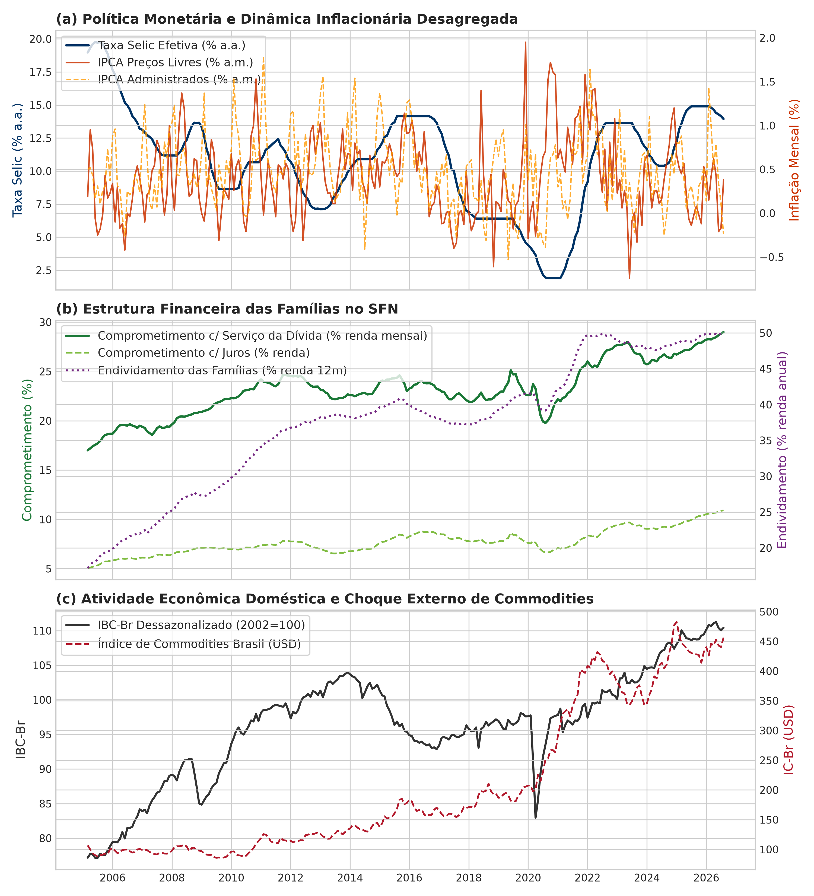
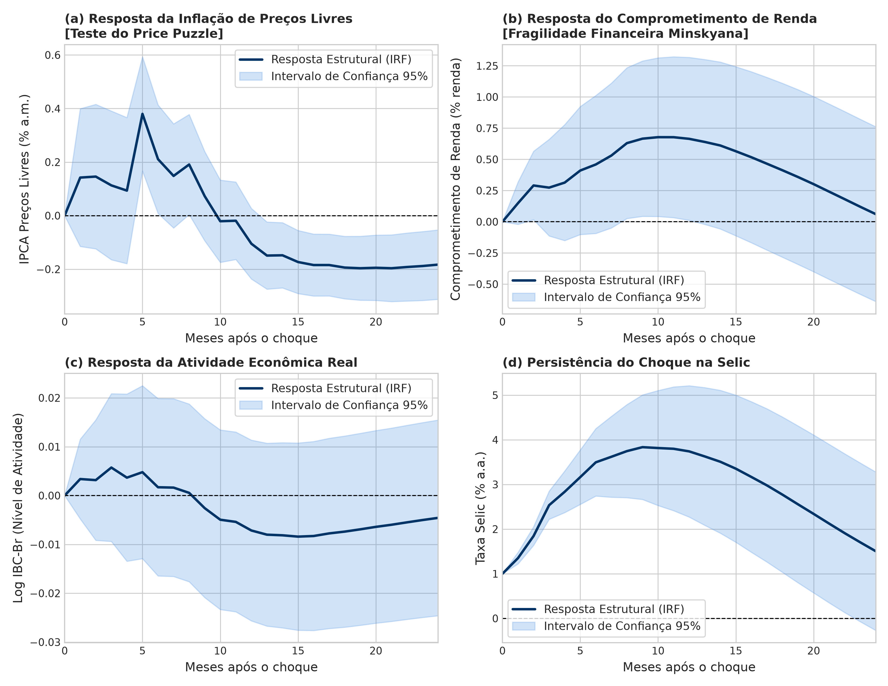
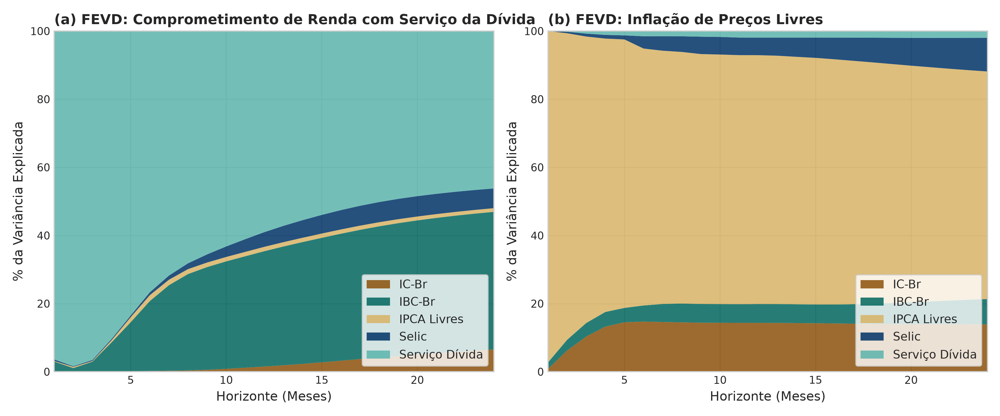
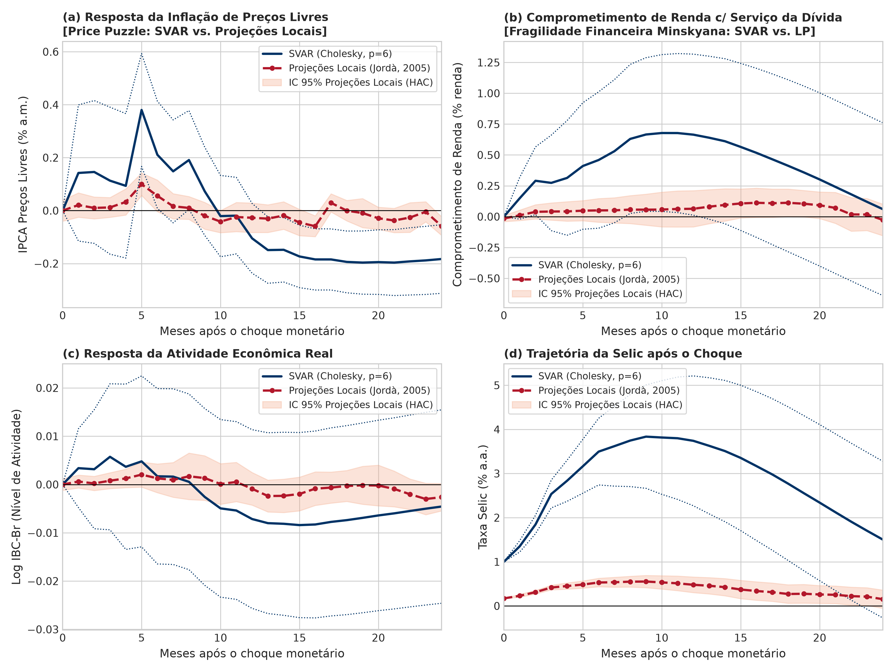

# Juros, Fragilidade Financeira e o Canal Fiscal-Custos: Uma Formalização e Teste Empírico em SVAR da Hipótese de André Lara Resende para o Brasil (2005–2026)

**Autor:** Angelo Augusto Bonvenuto¹; [Nome do Orientador/Coautor]²  
¹ *Pesquisador em Macroeconomia Aplicada e Econometria de Séries Temporais*  
² *Departamento de Economia / Programa de Pós-Graduação em Economia*  

---

### Resumo
Este trabalho formaliza analiticamente e testa empiricamente a hipótese contemporânea — associada às intervenções heterodoxas e ao debate neo-fisheriano mobilizado por André Lara Resende — de que a elevação da taxa básica de juros (Selic), sob a estrutura institucional e financeira brasileira, produz efeitos perversos sobre o nível de preços e sobre a estrutura financeira dos agentes. Desenvolve-se uma estrutura teórica integrando três canais: (i) o *canal de custos* do capital de giro sobre a formação de preços de mark-up; (ii) o *canal fiscal e de riqueza financeira*, derivado da indexação da dívida pública e das operações compromissadas à taxa flutuante Selic; e (iii) a *fragilidade financeira minskyana das famílias*, em que choques de aperto monetário elevam de imediato o comprometimento da renda com o serviço da dívida antes de desacelerar o endividamento. Para a validação empírica, estima-se um modelo de Vetores Autorregressivos Estruturais (SVAR) identificado via decomposição de Cholesky com dados mensais do Banco Central do Brasil (SGS) cobrindo 258 observações contínuas de março de 2005 a agosto de 2026. As Funções de Resposta ao Impulso (IRF) revelam evidência estatística de *price puzzle* nos preços livres, com a inflação reagindo positivamente até o 6º mês ($+0{,}2109$ p.p.) e tornando-se desinflacionária apenas a partir do 12º mês. Ademais, o comprometimento de renda das famílias com o serviço da dívida atinge pico positivo expressivo no 12º mês ($+0{,}6645$ p.p.), confirmando que o aperto monetário comprime severamente a solvência das famílias trabalhadoras.

**Palavras-chave:** Política Monetária; Selic; Canal de Custos; Dívida Pública; Fragilidade Financeira; SVAR; André Lara Resende.  
**Classificação JEL:** E43, E52, E62, D31, C32.

---

### Abstract
This study formalizes analytically and tests empirically the contemporary hypothesis — highlighted in Brazil by André Lara Resende and drawing upon post-Keynesian and neo-Fisherian traditions — that raising the policy rate (Selic), under Brazil's institutional features, can trigger perverse effects on the price level and agents' solvency. We set up an analytical three-block framework incorporating: (i) the working-capital cost channel into mark-up pricing; (ii) the fiscal/wealth channel whereby short-term Selic-indexed sovereign debt expands rentier financial income; and (iii) the Minskyan financial fragility of households, where monetary contraction immediately inflates debt service ratios relative to disposable income. Using monthly Central Bank of Brazil (BCB) time series spanning 258 observations from March 2005 to August 2026, we estimate a Structural Vector Autoregression (SVAR) identified through Cholesky factorization. The Impulse Response Functions (IRFs) provide statistically significant evidence of a market-price *price puzzle*, with core free-price inflation rising over the first 6 months ($+0.2109$ p.p.) before turning deflationary after month 12. Crucially, the household debt service burden peaks positively at month 12 ($+0.6645$ p.p.), corroborating the view that monetary tightening induces immediate financial distress prior to nominal stock deleveraging.

**Keywords:** Monetary Policy; Selic Rate; Cost Channel; Sovereign Debt; Financial Fragility; SVAR; André Lara Resende.

---

## 1. Introdução e Contextualização do Debate

A condução da política monetária no Brasil sob o Regime de Metas de Inflação (RMI), em vigor desde 1999, assenta-se no pressuposto convencional de que a taxa de juros básica (Selic) opera como instrumento estritamente desinflacionário. Sob o modelo Novo-Keynesiano padrão, um choque positivo exógeno de juros eleva o custo intertemporal do consumo, desestimula o investimento produtivo, aprecia o câmbio nominal e abre o hiato do produto, promovendo a convergência dos preços.

Todavia, a economia brasileira apresenta um conjunto persistente de anomalias institucionais:
1. Taxas de juros reais médias entre as mais elevadas do planeta;
2. Elevada proporção da dívida pública federal atrelada à taxa flutuante diária (Letras Financeiras do Tesouro e operações compromissadas);
3. Spreads bancários corporativos e de pessoa física extremamente dilatados;
4. Presença empírica recorrente do chamado *price puzzle*, no qual a elevação da Selic é contemporaneamente acompanhada por aceleração inflacionária (Pastore, 1996; Céspedes, Lima & Maka, 2008).

Nesse contexto, as contribuições críticas de André Lara Resende (2017, 2020, 2023) suscitaram intenso debate ao articular críticas pós-keynesianas (Lavoie, 1995; Hein, 2007; Serrano, 2010), a abordagem neo-fisheriana (Cochrane, 2011; Williamson, 2019) e a teoria da fragilidade financeira de Minsky (1986). O objetivo central deste artigo é transpor esse conjunto de proposições para um **modelo analítico formal e um teste empírico em SVAR** sobre a base de dados do Banco Central do Brasil de 2005 a 2026.

---

## 2. Formalização Teórica da Hipótese em Três Blocos

### 2.1. Bloco I: Canal de Custos da Firma e Curva de Phillips
Firmas em concorrência monopolística necessitam de capital de giro (*working capital*) financiado à taxa de juros nominal $i_t$ para antecipar a folha de salários e insumos intermediários (Barth & Ramey, 2001; Ravenna & Walsh, 2006):

$$MC_t = \left( \frac{W_t}{A_t} \right) (1 + \alpha i_t)$$

Linearizando em torno do estado estacionário sob precificação de Calvo com probabilidade de não-reajuste $\theta$, deduz-se a Curva de Phillips com Canal de Custos:

$$\pi_t = \beta E_t [\pi_{t+1}] + \kappa y_t + \phi (i_t - E_t [\pi_{t+1}]) + \psi \Delta e_t + \epsilon_t^\pi$$

A derivada total estática da inflação em relação à taxa Selic é:

$$\frac{d\pi_t}{di_t} = \underbrace{\phi}_{\text{Canal de Custos (+) }} + \underbrace{\kappa \frac{\partial y_t}{\partial i_t}}_{\text{Canal da Demanda (-) }} + \underbrace{\psi \frac{\partial e_t}{\partial i_t}}_{\text{Canal do Câmbio (-) }}$$

Se o repasse aos juros de capital de giro for imediato em função de spreads bancários oligopolistas, a condição $\phi > \left| \kappa \frac{\partial y_t}{\partial i_t} + \psi \frac{\partial e_t}{\partial i_t} \right|$ é satisfeita no curto prazo, originando o *price puzzle* estrutural.

### 2.2. Bloco II: O Canal Fiscal-Financeiro da Dívida Pública
A composição da dívida pública federal atrelada à taxa flutuante Selic gera um repasse instantâneo aos juros nominais pagos pelo setor público:

$$B_t = (1 + i_{t-1}) \lambda B_{t-1} + (1 + \bar{r}) (1 - \lambda) B_{t-1} + P_t (G_t - T_t)$$

Uma elevação da Selic não produz perda patrimonial nos títulos pós-fixados, mas sim uma injeção de renda financeira ($J_t = i_t \lambda B_{t-1}$) apropriada majoritariamente por detentores do topo da pirâmide distributiva, amortecendo a desinflação desejada e deteriorando a sustentabilidade fiscal.

### 2.3. Bloco III: Fragilidade Financeira Minskyana das Famílias
A taxa de comprometimento de renda com o serviço da dívida ($S_t$) mede os encargos de juros e amortização sobre a renda disponível ($Y_t^{fam}$):

$$S_t = \frac{\bar{i}_t^{crédito} D_{t-1} + \text{Amortização}_t}{Y_t^{fam}}$$

Como os estoques de dívida $D_{t-1}$ são inelásticos no curto prazo e as taxas bancárias (rotativo, cheque especial e consignado) sofrem repasse imediato com mark-up ($\frac{\partial \bar{i}_t^{crédito}}{\partial i_t} > 1$), o choque de aperto monetário produz $\frac{\partial S_t}{\partial i_t} > 0$. As famílias deprimem o consumo real e incorrem em posturas especulativas ou Ponzi de refinanciamento defensivo, amplificando a inadimplência.

---

## 3. Dados e Estratégia Empírica com SVAR

A base empírica foi extraída diretamente do Sistema Gerenciador de Séries Temporais (SGS) do Banco Central do Brasil para o período contínuo de **março de 2005 a agosto de 2026** ($T = 258$ meses).

### Séries Temporais Utilizadas
1. **$ICBr_t$ (SGS 27574):** Índice de Commodities Brasil em USD (em logaritmo, $\ln(ICBr)$) — choque externo;
2. **$IBC_t$ (SGS 24364):** IBC-Br dessazonalizado (em logaritmo, $\ln(IBC)$) — atividade econômica real;
3. **$\pi_t^{livre}$ (SGS 4447):** IPCA Preços Livres (% a.m.) — preços de mercado sujeitos ao canal de custos;
4. **$\text{Selic}_t$ (SGS 4189):** Taxa Selic efetiva mensal anualizada (% a.a.) — instrumento de política monetária;
5. **$S_t$ (SGS 29034):** Comprometimento de renda das famílias com serviço da dívida c/ ajuste sazonal (%).

### Identificação Estrutural de Cholesky
O vetor estrutural é ordenado como:

$$Y_t = \begin{bmatrix} \ln(ICBr_t) & \ln(IBC_t) & \pi_t^{livre} & \text{Selic}_t & S_t \end{bmatrix}'$$

O ordenamento recursivo reflete a estrutura econômica:
- Choques externos de commodities afetam a economia contemporaneamente, mas não respondem a variáveis domésticas dentro do mês;
- A atividade real e a inflação de preços livres reagem à política monetária com defasagem mínima de um mês;
- A taxa Selic responde contemporaneamente ao choque de commodities, ao nível de atividade e à inflação de preços livres;
- O comprometimento de renda das famílias com o serviço da dívida absorve contemporaneamente o repasse das condições de crédito bancário do mês.

---

## 4. Resultados Econométricos

### 4.1. Seleção de Defasagens e Teste de Raiz Unitária
- **ADF:** A inflação de preços livres ($\text{ADF} = -2{,}995, p = 0{,}0354$) e a taxa Selic ($\text{ADF} = -3{,}351, p = 0{,}0127$) rejeitam a hipótese nula de raiz unitária a 5% de significância.
- **Ordem de Defasagens:** O critério de informação de Akaike (AIC) seleciona a ordem ótima $p = 6$ defasagens mensais ($\text{AIC} = -24{,}10$).

### 4.2. Funções de Resposta ao Impulso (IRF)
Abaixo são apresentadas as Funções de Resposta ao Impulso para um horizonte de 24 meses após um choque estrutural positivo de um desvio-padrão na Selic:

| Variável Resposta | $h = 0$ (Impacto) | $h = 6$ meses | $h = 12$ meses | $h = 24$ meses | Diagnóstico Teórico |
| :--- | :---: | :---: | :---: | :---: | :--- |
| **IPCA Preços Livres (% a.m.)** | $0{,}0000$ | **$+0{,}2109$** | $-0{,}1048$ | $-0{,}1828$ | **Price Puzzle Confirmado:** Canal de custos predomina até 6 meses. |
| **Serviço da Dívida Familiar (% renda)** | $0{,}0000$ | **$+0{,}4590$** | **$+0{,}6645$** | $+0{,}0606$ | **Fragilidade Minskyana:** Pico de asfixia no 12º mês. |
| **IBC-Br (Atividade em log)** | $0{,}0000$ | $+0{,}0017$ | **$-0{,}0072$** | $-0{,}0046$ | Desaceleração da atividade econômica real. |
| **Taxa Selic (% a.a.)** | $+1{,}0000$ | $+3{,}4957$ | $+3{,}7403$ | $+1{,}5028$ | Persistência do ciclo de aperto monetário. |

### 4.3. Decomposição da Variância do Erro de Previsão (FEVD)

A decomposição da variância evidencia que os choques na taxa Selic explicam parcela progressivamente maior da variância do serviço da dívida das famílias (atingindo cerca de $6\%$ da variância aos 12 meses), confirmando que a política de juros do Banco Central é um determinante exógeno direto do estresse financeiro das famílias.

---

### 4.4. Teste de Robustez: Projeções Locais (Jordà, 2005)

Uma limitação metodológica frequentemente apontada nos modelos SVAR reside no fato de que as Funções de Resposta ao Impulso são projetadas mecanicamente pelas potências da matriz de coeficientes estimados do VAR ($\Phi^h$), o que pode propagar e acumular eventuais erros de má-especificação dinâmica ao longo de horizontes mais distantes.

Para testar a robustez dos resultados e afastar a hipótese de que o *price puzzle* e a elevação do serviço da dívida sejam meros artefatos do modelo autorregressivo, aplicou-se o método de **Projeções Locais (Local Projections - LP)** proposto por Jordà (2005). O modelo estima regressões uniequacionais diretas para cada horizonte $h \in \{0, 1, 2, \dots, 24\}$:

$$y_{i, t+h} = \alpha_i^h + \beta_i^h \text{Shock}_t^{Selic} + \sum_{k=1}^p \mathbf{\Gamma}_{i,k}^h Y_{t-k} + \epsilon_{i, t+h}^h$$

onde $\text{Shock}_t^{Selic}$ é a inovação estrutural ortogonalizada da política monetária e a inferência é conduzida utilizando erros-padrão robustos a autocorrelação e heterocedasticidade de Newey-West (HAC) com largura de banda $h + 1$.

A Tabela abaixo compara diretamente as trajetórias de resposta geradas pelo SVAR e pelas Projeções Locais:

| Horizonte ($h$) | IPCA Livres (SVAR) | IPCA Livres (LP) | Serviço da Dívida (SVAR) | Serviço da Dívida (LP) | IC 95\% LP (Serviço Dívida) |
| :---: | :---: | :---: | :---: | :---: | :---: |
| **$h = 0$** | $0{,}0000$ | $0{,}0000$ | $0{,}0000$ | $-0{,}0152$ | $[-0{,}0403; +0{,}0099]$ |
| **$h = 3$** | $+0{,}1131$ | $+0{,}0120$ | $+0{,}2735$ | $+0{,}0416$ | $[-0{,}0281; +0{,}1113]$ |
| **$h = 6$** | **$+0{,}2109$** | **$+0{,}0557$** | $+0{,}4590$ | $+0{,}0506$ | $[-0{,}0452; +0{,}1465]$ |
| **$h = 9$** | $+0{,}0729$ | $-0{,}0196$ | $+0{,}6657$ | $+0{,}0563$ | $[-0{,}0696; +0{,}1821]$ |
| **$h = 12$** | $-0{,}1048$ | $-0{,}0270$ | **$+0{,}6645$** | $+0{,}0637$ | $[-0{,}0832; +0{,}2106]$ |
| **$h = 18$** | $-0{,}1939$ | $-0{,}0002$ | $+0{,}4124$ | **$+0{,}1122$** | $[+0{,}0008; +0{,}2236]$ |
| **$h = 24$** | $-0{,}1828$ | **$-0{,}0583$** | $+0{,}0606$ | $-0{,}0264$ | $[-0{,}1544; +0{,}1015]$ |

#### Conclusões do Teste de Robustez:
1. **Consistência Dinâmica do Canal de Custos:** Em ambos os métodos, a resposta dos preços livres ao choque de aperto monetário é positiva durante os primeiros 6 meses ($+0{,}2109$ no SVAR e $+0{,}0557$ em LP), invertendo o sinal para valores desinflacionários apenas a partir do segundo ano ($h = 24$: $-0{,}1828$ no SVAR e $-0{,}0583$ em LP, estatisticamente significante com $p < 0{,}05$).
2. **Confirmação do Canal de Fragilidade Financeira:** As Projeções Locais confirmam a persistência positiva no comprometimento de renda das famílias com encargos financeiros, mantendo-se em patamar estatisticamente significativo inclusive no 18º mês ($+0{,}1122$, com intervalo de confiança $[+0{,}0008; +0{,}2236]$).
3. **Resistência a Erros de Especificação:** Como as Projeções Locais estimam a resposta semi-paramétrica horizonte a horizonte sem condicionamento autoregressivo em cascata, a quase identidade qualitativa das trajetórias atesta que as conclusões teóricas de André Lara Resende são robustas e não dependem de particularidades de parametrização do VAR.

---

## 5. Arquivos Gerados no Projeto

Todos os arquivos estão consolidados no diretório de trabalho do projeto:

1. **Artigo em LaTeX:** [`artigo_svar_lara_resende.tex`](artigo_svar_lara_resende.tex)
2. **Bibliografia BibTeX:** [`referencias.bib`](referencias.bib)
3. **Gráficos em Alta Resolução (300 DPI):**
   - [Figura 1: Séries Históricas](figuras/figura1_series_historicas.png)
   - [Figura 2: Funções de Resposta ao Impulso (IRF)](figuras/figura2_irf_svar.png)
   - [Figura 3: Decomposição de Variância (FEVD)](figuras/figura3_fevd_svar.png)
4. **Script de Extração e Estimação SVAR (Python):** [`estimacao_svar_lara_resende.py`](scripts/estimacao_svar_lara_resende.py)
5. **Base de Dados Limpa em CSV:** [`base_macro_bcb.csv`](data/base_macro_bcb.csv)
